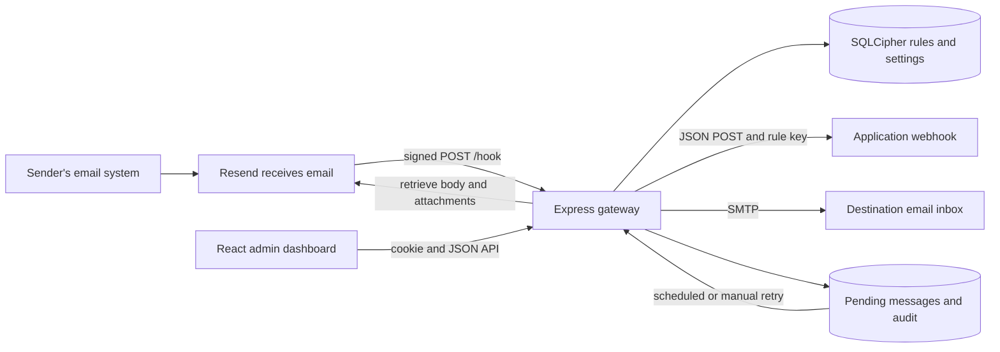

# Jahosi Mail: a guided lecture through the repository

Audience: undergraduate students in communications and web technology. This lecture describes the checked-in repository as inspected on 22 October 2026. Keep the source open beside this document and follow the paths as you read.

Our question is practical: **how does an incoming email become either an HTTP request or a forwarded email, and how can an administrator control that process?** We will follow that journey, explain the language used to implement it, and account for the supporting files and images.

## 1. Learning route and scope

By the end, you should be able to trace a browser action to its server handler and database query; distinguish SMTP, HTTP, JSON, HTML and MIME; explain authentication and message signatures; read TypeScript and React; and describe what happens when delivery fails.

This is a substantial lecture suitable for several classes: language and architecture, backend, frontend, then testing and critique. Read sections 2–4 first, follow sections 5–13 with the source, and use the appendices as a reference while tracing individual lines.

“Every file” here means every version-controlled project file. Generated `dist/` directories, installed `node_modules/`, Git's internal `.git/` database, local secrets and runtime databases are explained as categories rather than reproducing third-party code or private data. Every project source file is covered below. Repeated punctuation and library operations are explained once in the language guide; the source index at the end locates declarations and function-call sites, including callbacks and constructors. A binary image is explained through its format, appearance and use, rather than treating compressed bytes as executable statements.

## 2. The communication system before the code

Jahosi Mail is a gateway, with an administrative website. It does not implement a listening SMTP server or an inbox interface. Resend receives email and tells this application about it using an HTTP webhook. An administrator creates rules matching the part of a recipient address before `@`. The first enabled matching rule chooses a destination.



The arrows carry different representations. SMTP transports email. HTTP carries requests and responses. JSON represents structured data inside some HTTP bodies. HTML represents the dashboard and some email bodies. MIME describes email parts such as text, HTML and attachments. SQL reads and writes persistent records. TypeScript describes the program, then becomes JavaScript for execution.

Imagine `apps@jahosi.co.uk` receiving a message. Its local part is `apps`. A wildcard rule `apps` can select `mailto:owner@example.net`. A regex rule `^ticket-(\d+)$` could instead match `ticket-42` and send to `https://example.net/tickets/{ID}`, replacing `{ID}` with `42`. These are alternative destinations for a recipient: matching stops at the first enabled rule.

Three identifiers must remain distinct: Resend's `email_id`, the gateway's newly generated message UUID for each distinct recipient, and an audit row's integer ID. One email can produce several gateway UUIDs, each with several audit rows.

## 3. Read the notation before reading the implementation

### 3.1 JavaScript and TypeScript symbols

| Syntax | Meaning here |
| --- | --- |
| `import x from "package"` | Import a module's default export. A bare package name resolves from installed dependencies. |
| `import { x }`, `export { x }` | Import/export a named binding. `export const` and `export function` declare and expose bindings together. |
| `import type`, `interface`, `type` | Compile-time descriptions, erased from emitted JavaScript. They do not validate incoming network data. |
| `"node:crypto"`, `"node:fs"` | Explicit Node standard-library modules. Browsers do not expose these Node filesystem APIs. |
| `./`, `../`, `.js` in backend imports | Current/parent directory paths. TypeScript's NodeNext setup resolves source `.ts` files while preserving imports suitable for emitted `.js`. |
| `const`, `let` | A binding that cannot be reassigned, or one that can. A `const` object's properties can still change. |
| `name: string`, `: Promise<T>` | Parameter/property/return-type annotations. A colon in an object literal instead separates a key from its value. |
| `=>`, `function` | Function definitions. Arrow functions are frequently passed as callbacks to another function. |
| `f(a, b)` / `object.method(a)` | Call a function/method with arguments. Parentheses may also group an expression. |
| `new Error`, `new URL`, `new Date` | Construct an instance. `throw` rejects the normal execution path; `try/catch/finally` handles failure and cleanup. |
| `async`, `await` | Produce a promise and wait for a promise's result. Awaiting network I/O does not make the whole Node process stop handling other work. |
| `return`, bare `return` | Finish this function with a value, or with `undefined`. Route handlers often return after sending an error. |
| `{}`, `[]` | Blocks/objects and arrays; context determines which. `array[0]` indexes, `object[key]` accesses a computed property. |
| `{ email }`, `{ email: value }` | Shorthand property using the variable's name, or an explicitly named property. |
| `const { hostname } = ...`, `[value, setter]` | Object or array destructuring. React's state hook returns a two-item array. |
| `...object`, `...array` | Spread properties/elements into another value. Later object properties override earlier ones. `...args` in a parameter collects rest arguments. |
| `?` on a property/parameter | Optional in a type. `string \| null` explicitly permits a null value. |
| `?.` | Optional chaining: return `undefined` if the value before it is null/undefined. `remove?.(...)` calls only if the method exists. |
| `??` | Choose the right side only for null/undefined. Unlike `\|\|`, this preserves `0`, `false` and `""`. |
| `&&`, `\|\|`, `!` | Short-circuit AND, OR and logical negation; also used to conditionally render JSX. |
| `===`, `!==`, `<`, `>=` | Strict equality/inequality and comparisons. `=` assigns; `+=` increments or concatenates; `++` increments by one. |
| `condition ? a : b` | Conditional expression choosing one value. |
| `+`, `-`, `*`, `/` | Arithmetic; `+` also concatenates strings. `60_000` is 60000 with a readability separator. |
| `as T`, `as const`, postfix `!` | Type assertion, preservation of literal/readonly types, and non-null assertion. None checks reality at runtime. |
| `<T>`, `T[]`, `Record<K,V>`, `Omit<T,K>` | Generic parameter, array type, keyed mapping type, and type excluding selected properties. These angle brackets are not HTML. |
| `typeof`, `instanceof`, `in` | Examine a runtime primitive category, instance relationship, or property presence. In a type expression, `typeof tabs` obtains the variable's type. |
| Backticks and `${expression}` | Template strings interpolate values and can span lines. They also build SQL and URLs here. |
| `;`, `,`, `.`, comments | Statement terminator, item separator, member access, and explanatory text. Semicolons are omitted in some Vite template files without changing their purpose. |
| `//`, `/* ... */`, `/** ... */` | Single-line, block and documentation comments. `eslint-disable-next-line` is a linter directive, not runtime logic. |

`unknown` means “inspect before using”; `any` would waive that obligation. Zod schemas provide runtime inspection. Generic `get<T>()` merely tells the compiler what shape the author expects from SQL; it does not prove the row has that shape.

An object method passed as `then(setHelpHtml)` is still invoked later by the promise, although there is no `setHelpHtml(...)` expression at that site. Similarly, Express invokes middleware, React invokes component functions and effects, and array methods invoke their supplied callbacks. The final source index also identifies these callback-bearing expressions.

### 3.2 Repeated library calls

| Calls | How to read them |
| --- | --- |
| `map`, `filter`, `find`, `some` | Transform each element; retain matching elements; find the first match; ask whether any match. |
| `push`, `join`, `slice` | Append to an array; combine elements into a string; take part of a sequence. `slice(0, 2000)` limits diagnostic length. |
| `includes`, `startsWith`, `endsWith` | Test string/array membership or string boundaries. |
| `trim`, `toLowerCase`, `toUpperCase` | Remove surrounding whitespace or normalize letter case. |
| `split`, `replace`, `replaceAll`, `match` | Divide text, substitute text, substitute all occurrences, or extract a regex match. Replacement callbacks compute replacement text. |
| `Object.entries`, `Object.keys`, `Object.assign` | Get key/value pairs, get keys, or copy properties. |
| `String`, `Number`, `Boolean`, `Number.isNaN`, `Math.max`, `Math.floor` | Convert values, detect a failed numeric conversion, choose a lower bound, or round down. |
| `Date.now`, `getTime`, `toISOString`, `toUTCString` | Milliseconds since the epoch, instance milliseconds, a machine-readable UTC timestamp, or a mail-style UTC timestamp. |
| `JSON.stringify`, `JSON.parse` | Serialize JavaScript data into JSON text and parse text back into values. JSON does not preserve functions or type annotations. |
| `Buffer.from`, `toString`, `arrayBuffer` | Convert bytes/text. Specify encodings such as UTF-8, hexadecimal or Base64 where appropriate. |
| `Promise.all`, `then`, `catch` | Await independent promises together, continue after success, or handle rejection. |
| `setTimeout`, `clearTimeout`, `setInterval` | Schedule one callback, cancel a scheduled callback, or schedule repeated callbacks. Durations are milliseconds. |
| `fetch`, `response.ok`, `json`, `text` | Make an HTTP request, check 2xx status, decode JSON, or read text. A non-2xx response does not automatically make `fetch` throw. |
| `AbortSignal.timeout` | Produce a signal that aborts an operation after the specified duration. |
| `encodeURIComponent`, `URL`, `URLSearchParams` | Encode a URL component, parse a URL, or construct/read form/query parameters. Encoding is not encryption. |

### 3.3 Regex, SQL, HTML and CSS notation

In `/pattern/flags`, the slashes delimit a regular expression. `^` and `$` anchor start/end; `.` matches a character; `*`, `+` and `?` mean zero-or-more, one-or-more and optional; `{64}` repeats exactly 64 times; `[...]` is a character class; `[^...]` negates it; `(...)` captures; `(?:...)` groups without capturing; `|` separates alternatives; `\d` matches digits; `\s` whitespace; `\b` a word boundary; `\p{L}` and `\p{N}` Unicode letters and numbers. Flags `i`, `g`, `u` mean case-insensitive, global and Unicode-aware. Escaping differs between a regex literal and a JavaScript string used to build a regex. `$&` in replacement text reinserts the full matched substring; `$1` reinserts capture group one. `regex.exec()` returns captures or null; `regex.test()` returns a boolean.

SQL's `?` is a bound parameter placeholder, independent of TypeScript's optional marker. `SELECT`, `FROM`, `WHERE`, `ORDER BY`, `LIMIT` and `OFFSET` retrieve, filter, order and page records. `INSERT`, `UPDATE` and `DELETE` mutate records. `CREATE TABLE`, `ALTER TABLE` and `PRAGMA` define or configure storage. `PRIMARY KEY`, `UNIQUE`, `NOT NULL`, `CHECK` and `DEFAULT` constrain values. `AS` aliases columns. `LEFT JOIN` retains the left record even without a match. `COALESCE` chooses the first non-null value; `CASE WHEN` computes conditionally. `ON CONFLICT ... DO UPDATE` implements an upsert. Single quotes delimit SQL string literals; they do not delimit table names here.

HTML's `<tag attribute="value">...</tag>` structures content. JSX uses similar notation but embeds JavaScript with `{expression}`, uses `className`, and attaches functions through `onClick`, `onSubmit` and `onChange`. `<>...</>` groups sibling elements without an extra DOM wrapper. `key` lets React identify list items; it is not a visible attribute. A capitalized `<RulesPanel>` invokes a component. `required`, `minLength`, `maxLength`, `type` and `disabled` affect browser form behavior; server validation remains necessary.

CSS uses `selector { property: value; }`. `.card` selects a class, `#root` an ID, `*` every element, `:root` the document root, `:hover` a state and `::before` a generated pseudo-element. `&` in nested CSS refers to the enclosing selector. `@media` makes conditional rules. Units `px`, `rem`, `%` and `vh` measure pixels, root-relative text units, percentages and viewport height. `#0b1020` is a hexadecimal colour; `rgba(...)` adds alpha. `var(--accent)` reads a custom property. CSS functions such as `min`, `minmax`, `repeat`, `radial-gradient`, `rotateX` and `scale` compute layout or appearance; they are not JavaScript functions.

## 4. Repository map, dependencies and build files

There are two npm projects: root for the server, `client/` for the browser. Installing the root does not install the client's dependencies automatically.

### Root files

| File | What a student should learn from it |
| --- | --- |
| `README.md` | Project introduction, forwarding example and verification commands. It explicitly describes Windows build/test installation and mocked tests. |
| `package.json` | Package identity, ESM mode, executable scripts and direct dependencies. `main` points to built `dist/server.js`. Repository/bugs/homepage are metadata, not requests the application executes. `ISC` declares a licence identifier. |
| `package-lock.json` | npm lockfile version 3: exact dependency graph, versions, tarball locations and integrity hashes. Unlike a source import graph, it includes transitive and platform-specific build packages. |
| `tsconfig.json` | Backend compiler configuration: ES2022 target; NodeNext modules/resolution; `src` input and `dist` output; strict checking; Node ambient types. `esModuleInterop` helps import interoperability, `skipLibCheck` skips declaration-file checking, casing checks prevent platform surprises, and `resolveJsonModule` permits typed JSON imports. |
| `.env.example` | A configuration template, not a usable collection of credentials. Copy locally and replace placeholders; the JWT placeholder is shorter than the required 32 characters. |
| `.gitignore` | A broad Visual Studio/editor/build template plus relevant exclusions: `*.env`, `node_modules/`, `dist/`, `client/dist/`, `data/`. Patterns, `**` recursion and `!` re-inclusions govern Git tracking, not application security. Already tracked files are not untracked by adding a pattern. |
| `teaching.md` | This educational walkthrough, added for the requested teaching task. It is not loaded by the application. |

Read root scripts as a dependency chain:

| Script | Executed work |
| --- | --- |
| `dev` | `tsx watch src/server.ts`: run TypeScript and restart when source changes. |
| `test` | Compile server TypeScript, then use Node's test runner with experimental module mocking on `tests/*.test.mjs`. |
| `build` | First run `build:client`, then compile server TypeScript. `&&` in this shell script means the second command runs only if the first succeeds. |
| `build:client` | Run the client's build using `--prefix client`. |
| `start` | Execute already compiled `dist/server.js`; it does not build first. |
| `lint` | Run the client's ESLint configuration. It is not a backend lint command. |
| `reset-admin` | Run the TypeScript command-line password-reset script. |

Backend dependencies have concrete jobs: `express` handles HTTP routing; `helmet` sets security-related headers; `cookie-parser` populates cookies; `express-rate-limit` limits requests; `dotenv` loads local environment settings; `zod` checks runtime data; `@journeyapps/sqlcipher` provides encrypted SQLite-compatible persistence; `bcryptjs` hashes passwords/codes; `jsonwebtoken` signs/verifies sessions; `nodemailer` builds/sends mail; `svix` verifies provider webhooks. `uuid` is declared but current project code uses Node's `randomUUID` instead. Development dependencies include the TypeScript compiler, `tsx`, and `@types/*` declarations for libraries and Node; declarations describe APIs without implementing them.

### Client build and tooling files

| File | Explanation |
| --- | --- |
| `client/package.json` | A private ESM package with React and React DOM. Scripts run Vite development, `tsc -b && vite build`, ESLint and Vite preview. `private: true` prevents accidental npm publishing. Its `0.0.0` package version differs from the displayed application `v0.0.1`. |
| `client/package-lock.json` | Separate exact dependency graph for this package. Both lockfiles use records under `packages`, including `""` for the project itself. Record fields include `version`, `resolved`, `integrity`, `dependencies`, `dev`, `optional`, `engines`, `cpu`, `os` and `license`: package version, source, checksum, child requirements, development/optional flags, compatibility constraints and licensing. Read repeated records using this same schema. |
| `client/vite.config.ts` | `defineConfig({ plugins: [react()] })` configures Vite and its React transformation/development integration. There is no API proxy configuration here. |
| `client/eslint.config.js` | Flat config: ignore built `dist`; select TS/TSX; combine base JavaScript, TypeScript, React Hooks and React Refresh rules; expose browser globals. `defineConfig` structures configuration, `globalIgnores` adds exclusions. |
| `client/tsconfig.json` | No direct source files: references app and tooling projects. `tsc -b` follows these references. |
| `client/tsconfig.app.json` | ES2023 and DOM types, bundler module resolution, ES modules, Vite types, automatic React JSX transform, no emitted JS. Vite emits bundles instead. Build metadata goes under `node_modules/.tmp`. Unused variables/parameters and switch fallthrough are checked; `erasableSyntaxOnly` limits TS constructs to erasable ones. This file does not set `strict: true`. |
| `client/tsconfig.node.json` | Similar bundler/no-emit settings but Node types, no DOM library, and only `vite.config.ts` included. |
| `client/src/vite-env.d.ts` | Triple-slash reference loads Vite client declarations, including typing for asset imports. It executes no code. |
| `client/.gitignore` | Ignore dependencies, build/SSR output, logs, local overrides and editor artefacts; allow the listed editor extension configuration exception. |
| `client/README.md` | Vite scaffold guidance about React integration, compiler options and stronger lint configurations. Code examples are suggestions, not necessarily enabled settings. |

`^6.0.3` in a manifest allows compatible minor/patch updates within the major version; `~6.0.2` restricts movement to patch updates within the minor version. The lockfile records actual resolutions. Do not confuse a permitted version range with the installed version.

## 5. Configuration and encrypted persistence

### `src/config/env.ts`

`dotenv.config()` loads `.env` values into `process.env`. `envSchema` is a Zod object, and `.parse(process.env)` throws on invalid configuration. Importing this module therefore performs validation immediately.

Zod's `.string()`, `.number()`, `.object()`, `.array()`, `.record()`, `.enum()` and `.literal()` construct schemas. `.min`, `.max`, `.length`, `.int`, `.email`, `.url`, `.regex`, `.nullable`, `.optional` and `.default` constrain or modify them. `.coerce.number()` converts a string before checking it. `.safeParse()` returns a success/failure result; `.parse()` throws. `.refine()` adds custom logic; `.passthrough()` preserves unlisted object properties. Schema chaining means each method returns a schema to which the next method applies.

| Environment symbol | Role and defaults |
| --- | --- |
| `NODE_ENV` | Defaults to `development`; only that exact string disables secure cookies. |
| `PORT` | Numeric listening port, default 4010. |
| `PUBLIC_BASE_URL` | Required valid URL used in magic/reset links. |
| `TRUST_PROXY` | Defaults to string `1`, converted to true for `1` or case-insensitive `true`. |
| `JWT_SECRET` | Required session signing secret, minimum 32 characters. |
| `SESSION_COOKIE_NAME` | Defaults to `mail_admin_session`. |
| `ADMIN_EMAIL`, `ADMIN_PASSWORD` | Required seed administrator email and password of at least 10 characters. Existing database credentials are not overwritten on startup. |
| `SMTP_HOST`, `SMTP_PORT`, `SMTP_SECURE` | Mail transport host, port default 587, secure flag default `false`. Only exact `"true"` becomes true. |
| `SMTP_USER`, `SMTP_PASSWORD`, `SMTP_FROM_ADDRESS` | Required SMTP login and valid gateway sending address. |
| `TURNSTILE_SECRET_KEY`, `TURNSTILE_SITE_KEY` | Server verification secret and public browser widget key. |
| `CF_ACCESS_CLIENT_ID`, `CF_ACCESS_CLIENT_SECRET` | Optional settings accepted by the schema but unused by current runtime code. Their presence does not implement Cloudflare Access authentication. |
| `WEBHOOK_SIGNING_SECRET` | Initial inbound Svix secret; seeded into database settings. |
| `SQLCIPHER_DB_PATH`, `SQLCIPHER_KEY` | Database path default `./data/mail.db` and required encryption key. The relative path is interpreted from the process working directory. |

The exported `env` spreads parsed values, replaces the two string flags with booleans and applies `as const`. Configuration is centralized; it is not fetched anew from `.env` for each request.

### `src/db/sql.ts`

Module-level code finds the database directory with `path.dirname`, checks `fs.existsSync`, creates it recursively with `fs.mkdirSync` if needed, enables `sqlite3.verbose()` diagnostics and constructs `db` with `new sqlite3.Database`.

`run(sql, params = [])` wraps callback-based `db.run` in `new Promise<void>`. On `err`, `reject(err)` ends the success path; otherwise `resolve()` finishes. Exported `exec` is this same function under another name. `get<T>` wraps `db.get` and resolves one typed row or undefined; `all<T>` wraps `db.all` and resolves an array. These wrappers let services use `await` instead of nested callbacks. The database handle is also exported as `db`.

`initializeDatabase()` sets `PRAGMA key`, escaping single quotes in the key because this PRAGMA is constructed as SQL text. Normal data queries use placeholders. It enables foreign keys, then creates six tables:

| Table | Columns and meaning |
| --- | --- |
| `admin_user` | `id` is constrained to 1; unique `email`; `password_hash`; `created_at`; `reset_token`; `reset_token_expires`. This is a single-account design. |
| `auth_challenge` | UUID `id`, bcrypt `otp_hash`, `magic_token`, `expires_at`, `used` flag and `failed_attempts`. |
| `routing_rule` | Auto-increment `id`, human `name`, `pattern`, checked `pattern_type`, `endpoint_url`, `webhook_key`, numeric `enabled`, `created_at`. |
| `pending_message` | UUID `id`, JSON text `payload`, `sender`, `recipient`, `destination`, saved `webhook_key`, checked `status`, `attempts`, `last_attempt`, `received_at`, `last_error`. |
| `message_audit` | Auto-increment `id`, gateway `message_id`, `destination`, textual `status`, `event_time`, plus migrated nullable `error` and `attempt`. No full email body. |
| `app_setting` | Unique `key`, `value`, `updated_at`; stores mutable secrets/settings. |

Startup migrations attempt to add older missing columns for challenge attempts and webhook keys; their broad catches assume an existing column, although other SQL failures would also be swallowed. Missing rule keys are backfilled using SQLite `randomblob(32)`, `hex` and `lower`. Audit migrations inspect `PRAGMA table_info(message_audit)` and `.some(...)` before adding `error` and `attempt`. Creation is repeatable through `IF NOT EXISTS`.

SQLCipher protects the database at rest. Application code still handles plaintext secrets while running. Enabling `foreign_keys` does not create foreign-key relationships: these table definitions do not declare them.

### `src/types/models.ts`

`DeliveryStatus` is the union `PENDING | FAILED | BOUNCED`. Successful deliveries disappear from the queue and are represented in audit records, so success is absent from this queue type. `Rule` describes ID, name, pattern, destination, pattern type, webhook key, enabled flag and creation time. `PendingMessage` describes a smaller queue projection with camelCase dates. The current pending API instead returns snake_case fields; do not assume every declared interface is used by every query.

## 6. Authentication, challenge email and account administration

### `src/services/auth.ts`: all exported operations

`challengeExpiryMinutes = 10`, `resetExpiryMinutes = 30`, `maxOtpAttempts = 5` control challenge lifetime, reset lifetime and failed OTP allowance. The imports connect hashing, JWTs, cryptographic randomness, SQL, configuration and outgoing mail.

| Function | Input, calls, result and side effects |
| --- | --- |
| `ensureAdmin()` | Queries `admin_user`. If absent, `bcrypt.hash(ADMIN_PASSWORD, 12)` creates a salted hash and an insert seeds account 1. Separately seeds `webhook_signing_secret` only if the setting is absent. A cost of 12 is bcrypt work factor, not hash length. |
| `verifyPassword(email, password)` | Gets the single account; rejects missing account/hash or unequal email; otherwise returns `bcrypt.compare`. Email comparison is exact and case-sensitive here. |
| `createChallenge()` | Generates UUID challenge/magic tokens, a six-digit random integer with exclusive upper bound 1000000, a bcrypt cost-10 OTP hash and an ISO expiry. Inserts the row, constructs the magic URL, sends text/HTML mail, returns challenge ID. It sends to `env.ADMIN_EMAIL`, a significant difference from reading the current database email. |
| `verifyOtp(challengeId, otp)` | Rejects absent, used, expired or five-failure challenges. Compares code/hash; increments failures on mismatch; marks used on success. Returns boolean. |
| `verifyMagicToken(token)` | Finds by magic token; rejects missing/used/expired rows; marks the same challenge used. OTP and link are alternative ways to consume that challenge. It does not check `failed_attempts`. |
| `createSessionToken()` | `jwt.sign` embeds role `admin`, an eight-hour expiry, issuer `jahosi-mail`, audience `jahosi-mail-admin`, signed with `JWT_SECRET`. A signed JWT is not encrypted data. |
| `verifySessionToken(token)` | `jwt.verify` checks signature/expiry plus expected issuer/audience; returns false on exceptions. It does not explicitly inspect the decoded role claim. |
| `createPasswordReset(targetEmail?)` | Reads current database email; throws if account missing or supplied email differs. Saves a UUID token with 30-minute expiry, sends a `/reset-password?token=...` link to that database email, returns email and URL. |
| `consumePasswordReset(token, newPassword)` | Finds matching reset token, checks expiry, hashes new password at cost 12, clears token/expiry, deletes all outstanding challenges, returns true. Invalid/expired token returns false. |
| `pruneExpiredChallenges()` | Deletes challenge rows whose expiry text compares earlier than `CURRENT_TIMESTAMP`. ISO text and SQLite timestamp text use different separators; see the later critique of this comparison. |
| `getAdminEmail()` | Returns database email or environment fallback. |
| `updateAdminCredentials({ email, currentPassword, newPassword })` | Verifies current password, trims a supplied nonempty email, optionally hashes a new password, updates account, deletes challenges when password changes, returns success and next email. Failure returns `{ success: false }`. |
| `purgeExpiredFailedMessages()` | Deletes FAILED/BOUNCED queue rows when `datetime(last_attempt)` is older than 24 hours; keeps pending rows and audit history. |
| `getSettings()` | Returns key/value rows ordered by key. Filtering of the API key happens in the server route. |
| `setSetting(key, value)` | Parameterized upsert updating both value and timestamp. |
| `getSetting(key)` | Reads one value, returning undefined if absent. |

Challenge consumption uses separate reads and updates. Teach the intended one-use behavior without assuming those operations are atomic. Resetting passwords/changing credentials does not revoke already issued JWTs: there is no stored session revocation/version check.

### `src/middleware/auth.ts`

`requireAdmin(req, res, next)` reads `req.cookies[env.SESSION_COOKIE_NAME]`; a missing or invalid session receives HTTP 401 JSON and an early return. A valid session calls `next()` to let Express continue. `Request`, `Response` and `NextFunction` are type-only Express imports. This function is a gate attached to routes, not a login form.

### `src/middleware/csrf.ts`

`CSRF_COOKIE` names `csrf_token`. `issueCsrfToken(res)` creates 32 random bytes encoded as 64 hexadecimal characters and sets an eight-hour cookie: readable by JavaScript, secure outside development, SameSite strict. It also returns the token for the JSON response.

`csrfProtection(req, res, next)` requires both `X-CSRF-Token` header and cookie. It converts each to a Buffer, checks equal lengths, then uses `timingSafeEqual`. Missing/invalid tokens receive 403; success calls `next`. The length check prevents the comparison function from throwing for differently sized buffers; the catch handles other comparison failures. This is a double-submit design: agreement between cookie and header is checked separately from the JWT session.

### `src/services/turnstile.ts`

`verifyTurnstile(token, ip?)` creates `URLSearchParams` with server secret and client response, optionally `.set("remoteip", ip)`, POSTs form-encoded data to Cloudflare's verification endpoint, rejects non-2xx responses, reads JSON and accepts only `success === true`. It performs server-side verification: merely displaying a browser widget does not validate a login. This fetch has no explicit timeout; network exceptions propagate.

### `src/scripts/reset-admin.ts`

This is the second executable entry point. `process.argv.slice(2)` removes Node's executable/script arguments. Local `getArg(name)` finds the first `--name=value` argument with `.find` and `.startsWith`, then slices off the prefix; it does not implement `--email value`. `email = getArg("email")` feeds `run()`, which initializes storage, ensures the account exists, invokes `createPasswordReset(email)` and logs the target email/public base URL. `run().catch(...)` logs failure and `process.exit(1)` reports an unsuccessful command. The script requests a reset by email; it does not print a replacement password.

## 7. Routing and destination validation

### `src/services/rules.ts`

`webhookKeyBytes = 32`. `generateWebhookKey()` uses `randomBytes(...).toString("hex")`, yielding a 64-character key. It is a shared secret for downstream requests, distinct from the inbound Svix secret.

`listRules()` selects SQL fields with camelCase aliases and sorts descending ID for newest-first display. `createRule({...})` inserts values and uses a supplied key or generates one via `??`. `updateRule(id, payload)` updates name, pattern, destination, pattern type, webhook key and enabled flag using placeholders. `deleteRule(id)` deletes by ID. These mutations do not report whether an ID actually existed.

Private `wildcardToRegex(pattern)` escapes regex metacharacters, replaces wildcard `*` with `.*` and wildcard `?` with `.`, then wraps the result with `^` and `$`. Wildcard matching therefore covers the whole local part. Its wildcards do not create capture groups.

`matchRule(prefix)` gets enabled rules in ascending ID: oldest first. For each it constructs a case-insensitive `RegExp`, using raw regex or converted wildcard. Invalid patterns are caught and skipped. `regex.exec(prefix)` produces a match array; `result[1] ?? prefix` chooses the first capture or the whole prefix. It returns `{ rule, extractedId }`, or null if no match. A raw regex without anchors can match only part of a prefix. `countRules()` reads an enabled count with fallback zero; it is exported but unused by current application callers.

Pause and predict: with enabled wildcard `*` created before `apps`, which wins for `apps`? The older `*`. Newest-first display does not imply newest-first routing.

### `src/services/destination.ts` and `src/utils/net.ts`

`destinationSchema` refines a string. Exact lowercase `mailto:` triggers validation of the remaining substring as one email address. Otherwise `new URL(value)` must parse, protocol must be `http:` or `https:`, and `isPrivateHostname` must return false.

`PRIVATE_PATTERNS` blocks hostname strings matching localhost, 127.x loopback, 10.x, 172.16–31.x, 192.168.x, 169.254.x link-local, 0.0.0.0, IPv6 `::1`, and fc/fd unique-local prefixes. `isPrivateHostname(urlString)` parses the URL and `.some(pattern.test(hostname))`; malformed URLs return true.

The source comment says “resolves”, but this code does not resolve DNS. It is a hostname-pattern check, not comprehensive network destination enforcement. DNS results, redirects and unlisted address forms are not inspected here. Explain its implemented scope precisely when discussing server-side request forgery.

## 8. Obtaining and reconstructing email

### `src/services/resend.ts`: schemas and content retrieval

Private schema `receivedEmail` requires event type `email.received`, nonempty `data.email_id`, nonempty `data.from`, and a nonempty array of valid email recipients. Both nested/event `.passthrough()` calls retain unlisted provider metadata. `parseReceivedEmail(payload)` exposes `.safeParse()`.

`includeEmailContent(payload, apiKey)` returns the original payload unchanged when no key exists or parsing fails. Otherwise it fetches `/emails/receiving/{encoded email_id}` with a Bearer key and 15-second timeout. Failed status becomes `apiFailure(...)`; returned JSON must contain nullable `text`, nullable `html`, string-valued `headers` and optional `reply_to` array. It returns a new event object with original `data` plus retrieved fields. It does not mutate the input object. This schema does not import subject or attachment metadata from the content response; those remain from the original event.

### `buildForwardedEmail(to, payload, apiKey, sendingAddress)`

This exported async function returns Nodemailer `SendMailOptions`; it does not itself send an email.

1. Parse the event and enriched email fields. Subject defaults to empty; attachments default to an empty array. Each attachment needs ID, nullable filename and content type, with optional disposition and content ID.
2. Local helper `singleLine(value)` removes folded line breaks and trims. `header(name)` finds a case-insensitive header key using `Object.entries(...).find(...)`, then normalizes its value. `originalFrom` prefers the From header, falling back to event sender.
3. `displayName` takes text before `<`, removes punctuation except letters/numbers/whitespace/dot/underscore/hyphen, collapses spaces and limits to 100 characters. A bare address produces no display name. The outbound From address always remains the configured gateway address.
4. `replyTo` prefers the Reply-To header, then normalized nonempty API `reply_to` entries joined by commas, then original From. The human display name, sender mailbox and reply destination are separate communication choices.
5. `metadata` is an array of label/value pairs for From, To, Date, Subject and Reply-To, filtered to omit empty values. `textHeader` formats a forwarded-message block. Local `escapeHtml(value)` substitutes `&`, `<`, `>`, quotes and apostrophes with HTML entities using a character-to-entity mapping. `htmlHeader` formats equivalent metadata as HTML.
6. If an HTML body exists, insert the header immediately after its opening `<body...>` tag or prepend it to an HTML fragment. The regex replacement callback preserves the actual opening tag. Original email HTML is preserved, not sanitized by this metadata escaping.
7. Reject an existing case-insensitive `X-Jahosi-Forwarded` header and direct forwarding to any original recipient address. These checks reduce loops but are not a general graph analysis of mail routes.
8. For every attachment, fetch fresh metadata from the Resend attachment endpoint using Bearer authorization and 15-second timeout. Validate `download_url`, require HTTPS, then fetch bytes with a 30-second timeout. The second request carries no Resend authorization header. Convert `arrayBuffer()` to `Buffer`, preserving filename (fallback `attachment`), content type, disposition (fallback `attachment`) and CID (inline resource reference).
9. Return From object, destination, Reply-To, unchanged subject, text/HTML alternatives, attachment array and `X-Jahosi-Forwarded: email_id`. HTML-only email remains HTML-only; text is generated with metadata when text exists or HTML is absent. `disableFileAccess` and `disableUrlAccess` prevent Nodemailer from loading message content from file/URL references; this function has already downloaded the permitted bytes itself.

This sequence awaits all attachment retrieval before sending, so a retrieval failure does not intentionally send a partially assembled message. Download URLs are refreshed on each retry. Downloaded content is held in memory with no explicit size limit in this function.

### `src/services/mail.ts`

Module-level `transporter = nodemailer.createTransport(...)` configures SMTP host/port/security/authentication, a 15-second connection timeout and 60-second socket timeout. `secure: false` is not a declaration that TLS can never occur; it configures the transport's initial connection mode.

`forwardEmail(to, payload, apiKey)` awaits `buildForwardedEmail`, then `transporter.sendMail`. A send error is wrapped with `SMTP forwarding failed:` and sanitized diagnostic details. Assembly errors occur before that try block and retain their original stage.

`sendMail({ to, subject, text, html })` sends simpler service messages from `SMTP_FROM_ADDRESS`: OTPs, reset links and bounces. `sendBounceNdr({ sender, messageId, reason })` builds a report with Reporting-MTA, Arrival-Date, Final-Recipient, Action, Status and Diagnostic-Code lines, joins with newlines and sends it back to sender. Its report is text inside an ordinary mail; it does not construct a complete MIME `multipart/report` DSN. `original-sender` is literal placeholder text in its report field.

### `src/utils/errors.ts`

`redactDiagnostic(value)` chains replacements to mask `re_`/`whsec_` secrets, Bearer tokens, URL user/password sections and URL query strings, then truncates to 2000 characters. It is pattern-based redaction rather than a proof that every possible secret is removed.

`describeError(error)` returns `Unknown error` for non-Error values. For Error instances it reads optional `code`, `responseCode` and `cause.code`, filters empty values, joins codes and redacts the resulting message. The intersection type adds optional fields for typing without changing the error instance.

`apiFailure(response, stage)` tries to read JSON and a string `message`; non-JSON failures still retain status. It returns a new redacted Error combining stage, HTTP status and available provider reason. Callers use `throw await apiFailure(...)` because obtaining the diagnostic itself requires async body parsing.

## 9. Inbound webhook, queue and audit: `src/services/webhook.ts`

This module orchestrates routing and delivery. `retryLimit = 5` counts total attempts, including the initial attempt.

| Internal function | Walkthrough |
| --- | --- |
| `parseRecipientPrefix(to)` | Optionally extracts an address from angle brackets, splits at `@`, trims local part. The received-event schema already requires plain email strings; the angle-bracket branch is more permissive than that entry validation. |
| `buildDestination(url, extractedId)` | If present, replaces every literal `{ID}` with `encodeURIComponent(extractedId)`; otherwise returns URL unchanged. |
| `postPayload(endpoint, payload, webhookKey)` | Reads the current API key from settings on every attempt. A `mailto:` destination without a key throws. Enriches through `includeEmailContent`; sends mail via `forwardEmail` or JSON via HTTP POST with `X-Jahosi-Webhook-Key` and 15-second timeout. Non-2xx HTTP response throws. The downstream key is a shared header value, not a newly calculated HMAC signature. |
| `audit(messageId, status, destination?, error?, attempt?)` | Inserts one audit row, converting absent optional values to SQL null. |
| `processRecipient(payload, sender, toValue)` | Generates a fresh gateway UUID, extracts prefix and awaits `matchRule`. With no match, sends a bounce and audits BOUNCED without a queue row. With a match, builds destination and attempts delivery. Success audits SUCCESS attempt 1. Failure stores original JSON, recipient/sender, resolved destination, saved key, attempts=1 and diagnostic in PENDING, then audits PENDING. |

`verifyWebhookSignature({ rawBody, headers })` reads the database's current signing secret and three Svix headers. Missing values return false. It constructs `new Webhook(secret)` and calls `.verify(rawBody, headers)` inside a try/catch, returning a boolean. Construction is outside the try; an invalid secret format may throw instead of producing false. Signature verification needs the exact body text: parsing and reserializing JSON could change signed bytes.

`processInboundMessage(payload)` validates the event, lowercases all recipients and uses `new Set(...)` to deduplicate them. A sequential `for...of` awaits `processRecipient` for each, collecting results in `{ results }`. It is one delivery decision per distinct address, not per matching rule. Lowercasing the entire address is a deliberate simplification of email address handling. This deduplication only covers one event: there is no persisted incoming event ID uniqueness check across repeated webhook deliveries.

`retryPendingMessages()` queries PENDING rows last attempted at least five minutes ago, then processes them sequentially. Success deletes the queue row and records SUCCESS_RETRY with incremented attempt number. Failure increments the counter, saves fresh error/time and either records RETRY_FAILED or marks/audits FAILED once attempts reach five. With uninterrupted failures, the normal total is one initial plus four automatic retries. The minute scheduler checks eligibility; attempts do not happen at an exact five-minute clock boundary.

`listAudit(page, pageSize, messageId?)` computes `(page - 1) * pageSize`, selects newest audit IDs, optionally filters by message UUID, and separately counts matching rows. Its `LEFT JOIN pending_message` and `COALESCE/CASE` provide fallback error/attempt values for old audit rows only when current queue status matches audit status. It maps snake_case SQL fields into camelCase JSON and redacts errors again. A historic failure is not guaranteed to retain details if those details were never recorded and the queue row has gone.

`listPending()` selects queue metadata newest receipt first, leaves its names snake_case and redacts `last_error`. It returns FAILED and BOUNCED rows too, despite its name.

`retrySingleMessage(id)` fetches any retained queue row regardless of status, parses its original payload, retries the saved destination/key, deletes on success and audits SUCCESS_RETRY_MANUAL. On failure it increments attempts/error/time and audits RETRY_FAILED_MANUAL, returning false. It does not change status on failure or enforce the automatic retry ceiling. A FAILED row therefore stays FAILED after another failed manual attempt; a BOUNCED retained row can also be manually retried.

`bounceMessage(id)` reads sender, returns false if absent, sends a bounce, updates status/time to BOUNCED, audits the event and returns true. Queue content remains until cleanup. SMTP bounce errors can propagate before the update.

```mermaid
stateDiagram-v2
    [*] --> Match
    Match --> BOUNCED: no rule; send notice
    Match --> SUCCESS: first delivery succeeds
    Match --> PENDING: first delivery fails; attempts = 1
    PENDING --> PENDING: eligible retry fails below limit
    PENDING --> FAILED: failed total attempt 5
    PENDING --> Removed: automatic/manual success
    FAILED --> Removed: manual success
    PENDING --> BOUNCED: administrator bounce
    FAILED --> BOUNCED: administrator bounce
    FAILED --> Purged: 24 hours since last attempt
    BOUNCED --> Purged: retained queue row ages 24 hours
```



The diagram summarizes normal flows. A no-rule bounce has no queue row to purge, manual failure keeps current status, and retained bounced rows can be retried. SUCCESS and Removed here describe outcomes, not allowed `pending_message.status` values.

## 10. The HTTP application: `src/server.ts`

### Startup and middleware order

Imports assemble the services; `createPasswordReset` is imported here but not used. `fileURLToPath(import.meta.url)` and `path.dirname` recreate filename/directory values in an ES module. `clientDist` resolves `../client/dist` relative to this file; after compilation the file lives under root `dist`, so that path reaches the intended built client. `appVersion` is a hard-coded display string. `express()` constructs `app`.

If configured, `app.set("trust proxy", 1)` trusts one proxy hop for request information such as IP. `helmet(...)` installs default headers and a CSP allowing self plus `challenges.cloudflare.com` for scripts, frames and connections. `cookieParser()` populates `req.cookies`.

The next middleware invokes `express.json({ limit: "2mb" })` for all paths except exact `/hook`. That exception preserves raw bytes for signature checking. On `/hook`, `express.raw({ type: "application/json" })` uses its own default size limit, not the 2 MB JSON limit.

Four limiter objects define windows and maxima: `authLimiter` 20 per 15 minutes, `apiLimiter` 180/minute, `webhookLimiter` 120/minute, `staticLimiter` 300/minute. They emit standard limit headers and disable legacy headers. `/api` receives the API limiter, then certain auth endpoints also receive the auth limiter. These default limiter instances use process-local storage. `maxRegexPatternLength = 200` constrains submitted patterns, not regex execution time.

Express route methods map HTTP verb plus path to a callback. `req.body`, `req.query`, `req.params`, `req.header(...)` and `req.ip` read different request parts. `res.status`, `.json`, `.cookie`, `.clearCookie`, `.redirect`, `.type`, `.send` and `.sendFile` set status, serialize data, manage cookies, redirect or send content. Middleware is evaluated in registration order.

### All HTTP routes

Unless labelled public, admin routes below use `requireAdmin`. Mutating admin routes also use `csrfProtection`.

| Method and path | Validation, service calls and response |
| --- | --- |
| `GET /readyz` | Public JSON with status, application, version, ISO timestamp. It does not query the database or external mail services. |
| `GET /api/public/config` | Public Turnstile site key/version; never the server secret. |
| `POST /api/auth/request` | Auth-limited. Zod validates email, nonempty password/token. `verifyTurnstile`, then `verifyPassword`, then `createChallenge`. 400 invalid shape, 403 failed challenge, 401 bad credentials; otherwise challenge ID/message. |
| `POST /api/auth/verify-otp` | Auth-limited. UUID challenge and length-six string; `verifyOtp`; 400/401 on failure. Sets eight-hour HttpOnly session cookie and success JSON. Length six does not itself require digits. |
| `GET /api/auth/magic` | Auth-limited. String query token; missing 400, invalid/expired 401; otherwise session cookie and redirect `/`. |
| `POST /api/auth/logout` | Public; clears session cookie and returns success. It has neither admin nor CSRF middleware. |
| `POST /api/auth/reset-password` | Auth-limited. UUID token/password minimum 10; `consumePasswordReset`; invalid request/token 400, otherwise success. |
| `GET /api/admin/me` | `getAdminEmail`, version. Used by browser to check its session. |
| `GET /api/admin/csrf-token` | `issueCsrfToken` sets cookie and returns token JSON. Its `req` parameter is unused. |
| `GET /api/admin/rules` | `listRules()` JSON. |
| `POST /api/admin/rules` | Validate nonempty name, pattern length 1–200, wildcard/regex enum, `destinationSchema`, optional 64-hex key. `createRule`; HTTP 201 success. |
| `PUT /api/admin/rules/:id` | Same main fields but required key and `enabled` coerced number between 0 and 1; numeric ID checked only for NaN. `updateRule`. There is no integer constraint on enabled or positive/integer constraint on ID. |
| `DELETE /api/admin/rules/:id` | Reject NaN ID; `deleteRule`; success even if SQL matches no row. |
| `POST /api/admin/rules/generate-webhook-key` | `generateWebhookKey`; returns key without storing a rule. |
| `GET /api/admin/messages` | Query page integer ≥1 default 1; pageSize integer 5–100 default 20; optional UUID messageId. Calls `listAudit`, or 400 invalid query. |
| `GET /api/admin/pending` | `listPending` metadata JSON. |
| `POST /api/admin/pending/:id/retry` | Normalize potentially array-valued route param; `retrySingleMessage`; false becomes 400, true success. |
| `POST /api/admin/pending/:id/bounce` | Same ID extraction; `bounceMessage`; false becomes 404. |
| `GET /api/admin/settings` | `getSettings`; map only `resend_api_key` to `configured` or empty. The webhook signing secret is returned to the authenticated browser. |
| `PUT /api/admin/settings/resend-api-key` | Empty string removes key; otherwise trimmed `re_` prefix followed by allowed letters/numbers/underscore/hyphen. `setSetting`; validity of provider permissions is only discovered when used. |
| `PUT /api/admin/settings/webhook-signing-secret` | Nonempty string; `setSetting`. No Svix-format check here. |
| `PUT /api/admin/settings/account` | Optional valid email and/or minimum-ten-character new password; mandatory current password; refinement requires a requested change. `updateAdminCredentials`; bad password 401, success returns email. |
| `GET /api/admin/help` | Resolve/read `docs/dashboard-help.html` as UTF-8, replace `{{VERSION}}`, send HTML. File is read from disk per request. |
| `POST /hook` | Public but signed and webhook-limited. Obtain raw UTF-8 text, verify Svix headers before parsing JSON. Invalid signature 401; invalid JSON/event 400; other event types 200 IGNORED; valid event calls `processInboundMessage` and returns 202 results. |

A 202 response is acknowledgement of processing, not a promise that every destination received mail: results can contain SUCCESS, PENDING or BOUNCED. Signature validation precedes event validation. The fallback `JSON.stringify(req.body)` exists for non-Buffer input, but raw JSON Buffer input is the expected path.

After routes, `fs.stat(clientDist).then(...).catch(...)` checks whether client build output exists. If so, `express.static(clientDist)` serves it and `GET /{*splat}` sends its `index.html` for unmatched GET paths, supporting the reset route. An unknown GET API path may also reach this fallback. The second limiter registration means a fallback request can traverse the static limiter again. If the client directory is absent, no dashboard fallback is registered.

Private `start()` awaits database initialization and account seeding, then installs a 60,000 ms interval that sequentially retries mail, prunes challenges and purges old failed/bounced rows. Finally `app.listen(PORT, callback)` starts listening and logs. `start().catch` logs startup failure and exits with status 1. The interval's async rejection is not handled by that startup catch, and overlapping intervals are not prevented. Exporting `app` does not make importing this module side-effect-free: it also starts the service.

## 11. Browser entry and API bridge

### `client/index.html` and `client/src/main.tsx`

The HTML doctype selects standards mode, `lang="en"` declares language, UTF-8 specifies encoding, viewport supports mobile layouts, theme colour supplies browser chrome colour, and title names the page. Links reference `/favicon.ico` and `/manifest.webmanifest`. An external async/defer Turnstile script loads the widget API; the React app handles the possibility that it has not arrived yet.

The body contains `div#root` plus the module script `/src/main.tsx`. Vite transforms this development entry into built assets. `main.tsx` imports React `StrictMode`, `createRoot`, global `index.css` and `App`. `document.getElementById("root")!` asserts the container exists; it would not create a missing element. `createRoot(...).render(...)` mounts the app under StrictMode, which can repeat development effect setup/cleanup to expose mistakes.

### `client/src/types.ts`

Browser `Rule` mirrors the fields the UI needs: ID, name, pattern/type, destination, key, enabled. `AuditItem` includes ID, message UUID, nullable destination, status, eventTime, nullable error and attempt. `PendingItem` uses snake_case `last_attempt`, `received_at`, `last_error`, matching the current pending response. Separate client/server types can drift because they are not generated from a shared contract.

### `client/src/api.ts`

Private module variable `csrfToken` starts empty. Generic `request<T>(url, init?)` defaults method to GET, tests whether it is POST/PUT/PATCH/DELETE, then calls `fetch` with included cookies, JSON Content-Type and conditional CSRF header. It merges supplied headers and options. Because `...init` appears after the constructed `headers`, a supplied `init.headers` would replace the merged object; current API methods do not supply headers. Type `RequestInit` comes from browser declarations.

Non-2xx responses become Error with response text, often the raw JSON error string. Success inspects Content-Type and returns parsed JSON or text cast to T. This generic assertion does not validate the server response.

Every `api` method delegates to that helper:

| Method | Contract and purpose |
| --- | --- |
| `getPublicConfig()` | GET public site key/version. |
| `requestAuth(payload)` | POST email/password/Turnstile token as JSON; receive challenge ID. |
| `verifyOtp(payload)` | POST challengeId/otp; browser accepts returned cookie. |
| `getMe()` | GET current account/version. |
| `getCsrfToken()` | GET token, save it in the module variable, return response. |
| `logout()` | POST logout. |
| `listRules()` | GET typed rules. |
| `createRule(payload)` | POST rule draft; `Omit<Rule, "id" | "enabled">` removes server-assigned fields from the required input type. |
| `updateRule(rule)` | PUT full rule to its ID path. |
| `deleteRule(id)` | DELETE ID path. |
| `generateRuleWebhookKey()` | POST generation endpoint. |
| `listAudit(page, pageSize=20, messageId="")` | GET paged log; encode optional UUID filter in query string. |
| `listPending()` | GET queue metadata. |
| `retryPending(id)`, `bouncePending(id)` | POST corresponding queue action. |
| `getSettings()` | GET key/value array. |
| `setWebhookSecret(value)`, `setResendApiKey(value)` | PUT `{ value }` to respective settings routes. |
| `updateAdminAccount(payload)` | PUT requested account fields/current password. |
| `getHelp()` | GET HTML as text. |
| `resetPassword(payload)` | POST token/new password. |

All URLs are same-origin relative paths. The Vite config contains no proxy, so starting the frontend development server alone does not automatically forward these requests to port 4010.

## 12. React dashboard: `client/src/App.tsx`

### External API declarations and state

`declare global { interface Window { turnstile?: ... } }` teaches TypeScript about an optionally available browser global. It describes `render`, its selector/options/callbacks and widget ID return, plus optional `remove`. It does not load the widget script.

`tabs` is the literal tuple Overview, Rules, Pending, Server log, Settings, Help. `(typeof tabs)[number]` makes a union of its allowed entries for state. `turnstileLoadRetryMs = 250`, `maxTurnstileLoadAttempts = 40` bound polling to roughly ten seconds.

`App()` is a function component. Each `useState(initial)` gives the current value and a setter scheduling rendering. Re-rendering calls the function again; React preserves state by hook order.

| State/ref symbols | What they retain |
| --- | --- |
| `email/setEmail`, `password/setPassword` | Login fields. |
| `turnstileSiteKey/setTurnstileSiteKey`, `turnstileToken/setTurnstileToken`, `turnstileError/setTurnstileError` | Widget configuration/result/failure feedback. |
| `challengeId/setChallengeId`, `otp/setOtp`, `authenticated/setAuthenticated` | Login phase and authentication view. Server cookies remain the real authority. |
| `tab/setTab`, `version/setVersion` | Navigation and displayed version. |
| `rules/setRules`, `audit/setAudit`, `page/setPage`, `pending/setPending` | Data collections and Overview page. `audit` has total and items. |
| `logMessageId/setLogMessageId`, `helpHtml/setHelpHtml` | Selected log filter and fetched help markup. |
| `adminEmail/setAdminEmail`, `savedAdminEmail/setSavedAdminEmail` | Edited and last-fetched account email. |
| `currentPassword/setCurrentPassword`, `newPassword/setNewPassword` | Account-change fields. |
| `webhookSecret/setWebhookSecret`, `secretDirty/setSecretDirty`, `secretVisible/setSecretVisible` | Secret value, unsaved-edit marker and visibility. |
| `resendApiKey/setResendApiKey`, `resendConfigured/setResendConfigured`, `resendMessage/setResendMessage` | Newly entered key, saved-state indicator and action feedback. |
| `error/setError` | General UI feedback. |
| `turnstileWidgetIdRef` | Mutable widget ID via `useRef<string | null>(null)`. Changing `.current` does not render the component. |

`isResetRoute = useMemo(..., [])` computes whether pathname is `/reset-password` once per mount. No client router library is installed; reset selection uses the current URL directly. `useMemo` caches a value; `useCallback` caches a function identity; `useEffect` schedules synchronization after rendering; these are distinct jobs.

### Effects, helpers and their calls

The first effect runs on mount: `api.getPublicConfig()` updates version/site key; separately `api.getMe()` reads account email, gets a CSRF token and marks authentication true, or false on rejection. The public-config promise has no catch in that effect.

The second effect only operates when logged out, no challenge is pending and the site key is available. Locals `cancelled` and `attempts` belong to that effect run. Its local `renderTurnstile()` polls until `window.turnstile` exists, reports timeout after the retry allowance, removes a previous widget, then calls `window.turnstile.render("#turnstile", options)`. Success callback stores a token/clears error; expiry clears token; error clears token and sets feedback. Cleanup marks cancellation, removes a retained widget and clears the ref. The polling timeout is not explicitly cancelled, but the cancellation guard stops its later work.

`refreshAdminData(targetPage = page)` is wrapped in `useCallback` with `[page]`. `Promise.all` requests rules, audit, pending, settings and account concurrently. It sets all corresponding state, retrieves the signing secret, resets dirty state and derives the API-key configured flag from its masked setting value. One rejection rejects the combined operation. Refresh can overwrite an unsaved account/secret edit.

The next effect, dependent on authentication/page/helper identity, schedules a zero-delay refresh and cancels the timer during cleanup. A zero-delay timer queues work; it is not immediate execution. Another effect fetches Help only when authenticated and that tab is selected.

`login(event)` prevents native form submission, clears error, requires a widget token, then calls `api.requestAuth` and stores the challenge ID; failures display their message. `submitOtp(event)` prevents submission, verifies OTP, obtains CSRF token, marks authenticated and clears challenge state. Each is an event callback, not invoked on every render.

### Rendered views and inline handlers

The reset route returns `<ResetPasswordPage version={version} />`. Hooks above that return still run, so initial config/session effects also occur on that route. Logged-out rendering chooses credential form or OTP form based on challengeId. Controlled inputs use `value` plus `onChange(event => setter(event.target.value))`. The login button is disabled until a widget token exists. Password inputs mask display, not in-memory values.

Authenticated rendering shows header, Logout and navigation. Logout awaits `api.logout()` then `location.reload()`. Tab buttons map the tuple with stable keys, assign active class and set tab state. Conditional `tab === ... && (...)` selects content:

| View | Elements and handler behavior |
| --- | --- |
| Overview | Table of audit ID-related UUID, status, destination and time; `View log` sets filter and tab. Prev uses `Math.max(1, p - 1)`; Next increments without a last-page guard. Total traversals counts audit events, not unique email messages. |
| Rules | Renders `RulesPanel` with rules and async `onChanged` refreshing data. |
| Pending | Refresh button; table with queue status, attempts, destination, diagnostic and UTC attempt time. View log selects filter. Retry catches errors and always refreshes in `finally`. Bounce awaits action and refresh, without its own local catch. |
| Server log | Renders `ServerLogPanel` with UUID filter and callback clearing it. |
| Settings: Resend | Controlled masked input. Save trims/calls API, clears field, sets configured flag/message. Remove sends empty string and updates feedback. Both have catches; disabled rules avoid empty saves/unnecessary removes. `role="status"` announces feedback. |
| Settings: account | Controlled email/current/new password. Save builds payload including only changed email/nonempty new password, calls API, clears password fields and refreshes. Button requires current password and a requested change. |
| Settings: signing secret | Text/password toggle changes visibility; editing sets dirty; Save writes secret and clears dirty. It is a different secret from a rule's downstream webhook key. |
| Help | `dangerouslySetInnerHTML={{ __html: helpHtml }}` inserts server-provided HTML without React escaping. The file must be trusted. This insertion is not an iframe and has no isolated stylesheet scope. |

General error text and version footer appear below the authenticated content. Some inline async actions lack catches; React does not automatically turn every rejected handler promise into a friendly message.

### `ServerLogPanel({ messageId, onClear })`

Local states are `page/setPage`, `logs/setLogs`, `error/setError`, `loading/setLoading`, `refresh/setRefresh`. An effect with dependencies `[page, messageId, refresh]` schedules an async fetch `api.listAudit(page, 20, messageId)`, sets loading, updates results/error and clears loading in `finally`. Cleanup cancels the initial timer and marks `cancelled` so an obsolete response does not update state; it does not abort an in-flight fetch.

Show-all resets local page to 1 and invokes `onClear`. Refresh increments an otherwise invisible counter so the effect reruns. Log rows display UTC time, UUID, status, attempt fallback em dash, destination without `mailto:` and diagnostic or Delivered/empty fallback. `aria-busy`, `role="alert"`, disabled controls and empty-state text communicate loading/error/result states. Prev is bounded; Next is disabled when `page * 20 >= total`. Switching to a different message while the panel stays mounted does not automatically reset page except through the show-all handler.

### `RulesPanel({ rules, onChanged })`

`draft/setDraft` stores name, pattern, patternType, endpointUrl, webhookKey. `draftWebhookVisible/setDraftWebhookVisible` masks the new key; `visibleWebhookKeys/setVisibleWebhookKeys` is a numeric-ID-to-boolean record for existing rows; `destinationType/setDestinationType` selects email/webhook; `ruleError/setRuleError` displays failures.

Submit prevents normal form navigation, clears error, uses trimmed draft key or awaits `generateRuleWebhookKey`, then calls `createRule`. For email, it prefixes the trimmed destination with `mailto:`. Success resets the draft/visibility and awaits parent refresh; failure sets error. Even email rules receive a key although SMTP does not use it.

Each field copies the draft with `{ ...draft, field: newValue }`; directly mutating the existing draft would bypass the intended React update pattern. Pattern select casts the browser string to the allowed union. Destination select changes type and clears previous address. Destination input changes between browser `email` and `url` validation.

Webhook-only controls generate and show/hide draft keys. Existing rules render read-only data; webhook rows offer show/hide using functional state update and computed `[rule.id]`, and Copy uses `navigator.clipboard.writeText`. Masking is presentation: keys are already in browser memory. Enabled checkboxes convert boolean into integer 1/0, call `updateRule({...rule, enabled})`, then refresh. Delete calls `deleteRule` then refreshes. The UI does not provide general inline editing of rule patterns/destinations, though the API supports updates.

### `ResetPasswordPage({ version })`

Local `password/setPassword`, `message/setMessage` hold form state. `new URLSearchParams(window.location.search).get("token") ?? ""` reads the query token. Submit prevents navigation, calls `api.resetPassword({ token, password })`, then reports success or failure. A required password field enforces browser minimum 10 characters; the server independently enforces that. Reset does not automatically create a session or navigate home.

## 13. Styles, help and every asset

### Active stylesheet: `client/src/index.css`

`main.tsx` imports this file. `:root` defines dark colour scheme, font fallbacks and baseline colours. No font file or font download is included: Inter is used only if available, followed by system fonts. The universal selector applies border-box sizing; body removes margin, fills viewport and adds a radial gradient.

| Selectors | Design role |
| --- | --- |
| `.shell`, `.card`, `.full`, `.auth-card` | Grid-centred viewport, bounded translucent panel with border/radius/shadow, taller dashboard and narrower login. `width: min(1120px, 100%)` keeps cards within available width. |
| `.form-stack`, `.stack`, `.inline-form` | Stacked grid fields or responsive auto-fitting columns of at least 160px. |
| `button, input, select`, `button`, `button.active` | Shared dark controls, pointer cursor and active-tab border. |
| `.tabs`, `.header-row`, `.action-cell`, `.pager`, `.secret-row`, `.secret-row input` | Flex layouts, gaps, wrapping tabs, spaced header, grouped actions, secret input expansion. |
| `.log-table-wrap`, `.log-error` | Horizontal log scrolling; diagnostics preserve whitespace and wrap long strings with bounded cell widths. |
| `.subtle`, `.error`, `footer` | Secondary, failure and version colours/spacing. |
| `table`, `th, td` | Full-width collapsed table borders, spacing, text size/alignment, top-aligned cells. |
| `.help-body`, `.turnstile` | Scrollable bounded help panel and reserved widget height. |

Grid/flex/overflow decisions communicate hierarchy and keep complex operational data usable. They do not add semantic labels by themselves; several inputs rely on placeholders, which students can assess as an accessibility improvement opportunity.

### Unimported stylesheet: `client/src/App.css`

This is starter styling and is not imported by current application source. `.counter` defines a sample counter with nested hover/focus rules and custom-property colours; `.hero` positions `.base`, `.framework` and `.vite` graphics with stacking, perspective/rotation/scale; `#center` centres a flex column; `#next-steps` defines columns and `.icon`; `#docs` adds a divider; `#next-steps ul`, `.logo`, `a`, `.button-icon`, `li` style resource links; `#spacer` reserves space; `.ticks::before/::after` draw triangles with borders. Nested `@media(max-width: 1024px)` changes spacing, columns and borders on narrower screens. Variables such as `--accent`, `--border`, `--text-h`, `--social-bg` and `--shadow` are not defined by active `index.css`. Do not attribute this unused scaffold appearance to the live dashboard.

### Documentation files

`docs/TECHNICAL_REFERENCE.md` summarizes stack, endpoints, lifecycle, persistence and Resend/logging behavior. Use it as a map, then confirm fine details in source: “5 attempts” includes the initial attempt.

`docs/INSTALLATION_AND_TROUBLESHOOTING.md` gives Debian/PM2 installation, environment and reverse-proxy notes, reset command and diagnostics. It mentions Nginx/Cloudflare Tunnel and PM2 but no corresponding deployment configuration files are committed. Its install sequence omits the client's separate dependency installation; a complete build needs both package trees. Environment seed credentials do not overwrite an existing account, so changing `.env` is not a general password reset.

`docs/dashboard-help.html` is a complete HTML document sent by the help route. Head contains UTF-8/title and inline CSS; body includes mailbox emoji, `{{VERSION}}` badge, introductory text, a grid of Overview/Rules/Server log/Pending/Security cards and a troubleshooting list. Classes `.hero`, `.grid`, `.card`, `.badge` and tag selectors style it. The `{{VERSION}}` token is an application text substitution, not JavaScript or JSX. Injecting this complete document into an article does not create a separate document boundary; its broad body/card/heading style rules can affect the enclosing page. Help calls retries “up to five times”; implementation is five total automatic-path attempts.

### Asset inventory and SVG vocabulary

| File | Content and actual reference |
| --- | --- |
| `client/public/manifest.webmanifest` | JSON install metadata: full/short name, description, dark theme/background, standalone display, `/` start URL and 192/512 PNG icon records. Linked from index.html. No service worker registration exists in source, so this does not implement offline mail administration or an offline API cache. |
| `client/public/favicon.ico` | Browser tab icon linked by index.html; contains 16×16, 32×32 and 48×48 entries. |
| `client/public/favicon.png` | 64×64 raster envelope icon, dark tile/blue outline/light envelope; alternate asset not explicitly linked by current HTML. |
| `client/public/favicon.svg` | Alternate Vite-style purple lightning graphic with masks/blur filters; not the current linked favicon. |
| `client/public/icons/icon-192.png` | 192×192 dark icon with rounded blue outlined tile and light envelope; referenced by manifest. |
| `client/public/icons/icon-512.png` | 512×512 companion PNG declared in manifest for larger installed-app icon use. |
| `client/public/icons.svg` | Unused SVG symbol sprite containing `bluesky-icon`, `discord-icon`, `documentation-icon`, `github-icon`, `social-icon`, `x-icon`; also `bluesky-clip` clipping definition. Publicly copied, but no current UI `<use>` references it. |
| `client/src/assets/hero.png` | 343×361 transparent raster illustration of two floating rounded square layers with purple lower edges; leftover starter asset, not imported. |
| `client/src/assets/react.svg` | Cyan React atom logo, 256×228 viewBox; unused source asset. |
| `client/src/assets/vite.svg` | Purple lightning with parenthesis-like sides, 77×47 viewBox; unused source asset. Includes a title and dark-mode styling for `.parenthesis`. |

Vite copies `public/` assets under their root-relative names, even unused ones. Assets under `src/assets/` normally need imports to join the bundle. Their mere presence is not evidence that the UI shows them. An arbitrary SVG is not executed as a TypeScript component here.

Read SVG as drawing instructions: `svg` establishes the image; `xmlns`/`xmlns:xlink` identify XML namespaces; `viewBox` defines coordinate space; width/height define nominal display size; `preserveAspectRatio` controls fitting; `path d` encodes geometric commands. Common `d` commands include `M/m` move, `L/l` line, `H/h` horizontal, `V/v` vertical, `C/c` cubic curve, `S/s` smooth cubic curve, `Q/q` quadratic curve, `T/t` smooth quadratic, `A/a` arc and `Z/z` close. Uppercase coordinates are absolute, lowercase relative. Numeric coordinate strings are data, not hidden function calls.

`fill`, `stroke`, `stroke-width`, line caps/joins and fill/clip rules determine painting. `g` groups; `defs` stores reusable definitions; `symbol id` defines reusable drawings; a consumer would use `use href="/icons.svg#github-icon"`. `clipPath` and `mask` restrict visibility; `url(#a)` references a local ID. `ellipse` uses centre/radii. `transform` applies matrices, rotation and scale. Filters `b` through `p` in the Vite artwork combine `feFlood`, `feBlend` and `feGaussianBlur` to create lighting. `filterUnits`, bounds, colour interpolation and `stdDeviation` define filter coordinate/blur behavior. `color(display-p3 ...)` provides a wide-gamut colour value. `title`, `aria-labelledby`, `aria-hidden` and `role` communicate image accessibility semantics; they are not routing rules.

PNG is compressed raster data; ICO is a multi-image icon container; SVG is vector XML. Resizing raster and vector assets therefore has different consequences for sharpness.

## 14. Tests as executable explanations

### `tests/inbound.test.mjs`

This ES module uses strict assertions and Node `test`, `mock`, `beforeEach`. Shared fixtures are `settings` Map, recorded `statements`, `sent` mail array, `pending`, `smtpError`, `auditRows`, `manualRow` and a mutable routing `rule`. `mock.module` replaces SQL, auth setting lookup, configuration and Nodemailer **before** dynamically importing built modules. This prevents native database loading and actual SMTP sending.

Mock SQL `all/get` choose results by SQL text; `exec(...args)` records arguments for later assertions. Mock transport records mail unless a fixture error is configured. `event()` returns a received envelope; `content()` returns body/header content. `beforeEach` restores method mocks, clears collections/resets fixtures, sets a test API key and mocks global `fetch` to a synthetic `Response.json`. Test addresses and keys are examples.

The 21 named tests cover these distinct behaviors: normal SMTP forwarding; attachment bytes without leaking API authorization to download host; original display name/mixed-case Reply-To; API Reply-To fallback; escaped metadata and insertion into HTML body; missing key queueing; Resend failure queueing; SMTP failure queueing; attachment failure without partial send; duplicate recipients; saved-destination retry with fresh content; loop/direct-self rejection; HTTP forwarding without a receiving API key; destination validation; malformed events; raw signature verification; redacted staged failure logs; automatic retry diagnostics/final failure; manual retry diagnostics; returned diagnostic redaction; network codes and URL/token redaction.

`mock.method`, `fetch.mock.mockImplementation` and `.mock.calls[n].arguments` replace behavior and inspect calls. `assert.equal` checks strict scalar equality; `deepEqual` checks structure; `ok` checks truthiness; `match` checks regex; `rejects` verifies async failure. `Response.json` and `new Response` build local fake responses. Svix `.sign(...)` produces a valid test signature; changing the body by one space then proves byte-sensitive verification. In the test titled “signed payloads”, HTTP output actually uses the shared key header; the assertion checks that header, not an outgoing signature.

### `tests/sender-format.test.mjs`

Imports real Nodemailer and its internal address parser, but creates a `streamTransport` with `buffer: true`, `newline: "windows"`. This serializes mail into memory with CRLF line endings; it does not contact SMTP.

The outer loop defines five original-From cases: simple named mailbox, quoted name, comma-containing name, bare address and angle-bracket-only address. Each registers a test. It builds a mail object, serializes it, isolates headers, unfolds continuation lines and extracts From/Reply-To using regex. `addressparser` checks a single valid mailbox, display name, reply destination, angle-bracket counts and SMTP envelope sender; it also checks preserved original sender in the text body. This tests actual serialization, a stronger check than inspecting only the pre-serialization object. Depending on an internal Nodemailer path is a maintenance consideration.

There are 26 test cases in total: 21 inbound cases plus five sender-format cases. They do not constitute browser interaction tests, native SQLCipher integration tests, real provider tests or exhaustive coverage of authentication/HTTP middleware. Mock SQL pattern matching cannot prove that actual schema migrations, joins and transactions work.

## 15. A complete trace to practise aloud

Trace login: index.html loads main.tsx; main mounts App; App fetches public config; Turnstile widget callback stores token; login handler calls api.requestAuth; request serializes JSON; Express JSON parser and rate limiters run; route validates input; Turnstile and password services verify; createChallenge stores a hash and emails code/link; OTP submission verifies and marks used; server sets JWT cookie; browser gets CSRF token; authenticated effects fetch dashboard data.

Trace delivery: Resend signs and POSTs an event; raw parser preserves bytes; signature verifier checks headers/body; route parses/validates; processInboundMessage deduplicates recipients; processRecipient generates UUID and matches rule; postPayload gets current key and enriches content; mail destination builds MIME-ready options/attachments then SMTP sends, or HTTP destination receives JSON/key; success is audited; failure saves original event and error; minute scheduler retries eligible rows; fifth failed total automatic-path attempt becomes FAILED; manual actions can retry/bounce; metadata appears in dashboard logs.

Predict this repair: SMTP fails on attempt 1, then you change a rule destination and fix credentials. The existing queue entry retains its resolved destination and webhook key. Retrying reads the current Resend API key but does not rerun rule matching. A new inbound event can use the new rule; an existing queued event keeps its saved destination.

## 16. Important distinctions and implementation limits

These observations come from the checked-in code; this document does not change application behavior.

| Tempting assumption | What the code actually does |
| --- | --- |
| “A successful health response proves mail delivery works.” | `/readyz` returns constants/time without dependency checks. |
| “Changing account email changes where login codes go.” | Account email is stored in SQL, but `createChallenge` mails environment ADMIN_EMAIL. Reset emails use the database email. |
| “Password reset logs out all sessions.” | It removes challenges, not existing signed JWTs. |
| “A webhook is delivered exactly once.” | Recipient deduplication is local to one event; provider replays can repeat delivery. Delivery and audit writes are not one transaction. |
| “Five retries follow the first attempt.” | Limit five means five total attempts on the normal automatic path. Manual attempts can exceed it. |
| “A rule's secret signs the outgoing JSON.” | The shared key is sent as `X-Jahosi-Webhook-Key`; inbound Svix verification is a different mechanism. |
| “All bounce paths are durable queue operations.” | No-rule bounce happens before audit and has no queued fallback if sending the bounce throws. |
| “Pending means only waiting messages.” | The listing includes retained FAILED and BOUNCED records. |
| “Public URL validation resolves private IPs.” | It checks hostname patterns only. Fetch redirect targets are not checked. |
| “The 200-character regex limit makes every regex fast.” | It limits length only; pathological valid expressions can still be expensive. |
| “Expiry cleanup compares identical timestamp formats.” | Challenge expiry is ISO text with `T`; SQLite CURRENT_TIMESTAMP uses a space. Lexical deletion can delay same-day cleanup; verification itself uses Date milliseconds. |
| “The queue worker has distributed locking.” | It is an in-process timer without row claiming or overlap guards. Multiple processes/timer overlap may duplicate work. |
| “Rendering Help isolates its HTML/CSS.” | It injects a complete HTML string into the existing page. |
| “The PWA manifest means offline capability.” | There is no service worker implementation in current project source. |

Discuss these as engineering reasoning exercises, not claims that hypothetical exploits have been demonstrated. Also distinguish encryption (database), hashing (passwords/OTPs), signatures (JWT/Svix), encoding (hex/Base64/URL escaping) and transport security (HTTPS/SMTP TLS). They solve different communication problems.

## 17. Guided lab and review questions

First read the repository and tests without configuring live mail. Root and client dependencies are separate: use `npm ci` and `npm ci --prefix client` in an appropriate supported environment. The README states SQLCipher runtime requires Linux/macOS; on Windows its documented backend build/test workaround is `npm ci --force --ignore-scripts`. That skips native installation scripts and does not make a native database runtime available.

For actual operation, replace `.env.example` placeholders in a private `.env`, including a valid long JWT secret, valid Svix secret, database key, SMTP and Turnstile configuration. Do not use live-provider credentials just to understand mocked tests.

The project's verification commands are:

```text
npm test
npm run build
npm run lint
```

These are instructions for a student, not a claim that the lecture-writing task executed them. `test` compiles first; `build` includes the client; `lint` checks only the client. Check compatible Node/dependency requirements from package metadata and the README. A built deployment needs `dist/`, `client/dist/`, `docs/dashboard-help.html`, runtime dependencies and private configuration; the TypeScript compiler does not copy the help HTML.

Exercises:

1. Trace a regex `^ticket-(\d+)$` and destination `https://example.net/tickets/{ID}` for `ticket-42@jahosi.co.uk`. Identify every conversion and first capture.
2. Explain why consuming raw bytes matters before signature verification, and why JSON serialization can change them.
3. Mark all trust boundaries crossed during SMTP forwarding: provider event, provider content, attachment URL, SMTP and administrator browser.
4. Compare the purpose, storage and disclosure of session JWT, CSRF token, OTP hash, Svix secret, downstream key and Resend API key.
5. Locate the statements that keep a failure visible after a later successful retry deletes the queue row.
6. Explain why refreshing the queue cannot automatically change a saved destination, why OTP email can work while forwarding fails, and why audit total is not an email count.
7. Suggest a meaningful test for the account-email discrepancy or worker concurrency. State what existing mocks cannot prove.

For each answer, point to a function and its caller. A convincing explanation describes both a value's shape and its journey across the system.

## Appendix A. Source declaration and call-site index

The following index is extracted from the project's JavaScript/TypeScript syntax trees: 25 source/tooling/test files, 1,454 declaration/member/import occurrences and 1,209 call/constructor occurrences. All 54 pre-existing tracked files are covered by name in this lecture. It supplements the explanations above: every named declaration is listed by source line, and call expressions/constructors are grouped by their written expression with all occurrence lines. Chained expressions are retained so you can see both the chain and its inner call. Inline arrows appear as callback declarations by line. Imported bindings, type/interface members and object property names are included as symbols. Source line numbers refer to this inspected revision and may change after edits.

### `client/eslint.config.js`

**Declared/imported symbols and member names** (name, role, source lines):

- `js (default import)`: 1.
- `globals (default import)`: 2.
- `reactHooks (default import)`: 3.
- `reactRefresh (default import)`: 4.
- `tseslint (default import)`: 5.
- `defineConfig (named import)`: 6.
- `globalIgnores (named import)`: 6.
- `files (member/key)`: 11.
- `extends (member/key)`: 12.
- `languageOptions (member/key)`: 18.
- `globals (member/key)`: 19.

| Call target (… means an inner call’s arguments) | Source lines | Reading guide |
| --- | --- | --- |
| `defineConfig` | 8 | Explained in the owning file walkthrough or shared language/library vocabulary; follow the named callee/import. |
| `globalIgnores` | 9 | Explained in the owning file walkthrough or shared language/library vocabulary; follow the named callee/import. |

### `client/src/App.tsx`

**Declared/imported symbols and member names** (name, role, source lines):

- `useCallback (named import)`: 1.
- `useEffect (named import)`: 1.
- `useMemo (named import)`: 1.
- `useRef (named import)`: 1.
- `useState (named import)`: 1.
- `FormEvent (named import)`: 2.
- `api (named import)`: 3.
- `AuditItem (named import)`: 4.
- `PendingItem (named import)`: 4.
- `Rule (named import)`: 4.
- `Window (interface)`: 7.
- `turnstile (member/key)`: 8.
- `render (member/key)`: 9.
- `selector (parameter)`: 10.
- `options (parameter)`: 11.
- `sitekey (member/key)`: 12, 111.
- `callback (member/key)`: 13, 112.
- `token (parameter)`: 13, 112.
- `"expired-callback" (member/key)`: 14, 116.
- `"error-callback" (member/key)`: 15, 119.
- `remove (member/key)`: 18.
- `widgetId (parameter)`: 18.
- `tabs (binding)`: 23.
- `turnstileLoadRetryMs (binding)`: 24.
- `maxTurnstileLoadAttempts (binding)`: 25.
- `App (function)`: 27.
- `email (binding)`: 28.
- `setEmail (binding)`: 28.
- `password (binding)`: 29, 699.
- `setPassword (binding)`: 29, 699.
- `turnstileSiteKey (binding)`: 30.
- `setTurnstileSiteKey (binding)`: 30.
- `turnstileToken (binding)`: 31.
- `setTurnstileToken (binding)`: 31.
- `turnstileError (binding)`: 32.
- `setTurnstileError (binding)`: 32.
- `challengeId (binding)`: 33.
- `setChallengeId (binding)`: 33.
- `otp (binding)`: 34.
- `setOtp (binding)`: 34.
- `authenticated (binding)`: 35.
- `setAuthenticated (binding)`: 35.
- `tab (binding)`: 36.
- `setTab (binding)`: 36.
- `version (binding)`: 37.
- `setVersion (binding)`: 37.
- `rules (binding)`: 38.
- `setRules (binding)`: 38.
- `audit (binding)`: 39.
- `setAudit (binding)`: 39.
- `total (member/key)`: 40, 42, 148, 490.
- `items (member/key)`: 41, 42, 148, 490.
- `page (binding)`: 43, 489.
- `setPage (binding)`: 43, 489.
- `pending (binding)`: 44.
- `setPending (binding)`: 44.
- `logMessageId (binding)`: 45.
- `setLogMessageId (binding)`: 45.
- `helpHtml (binding)`: 46.
- `setHelpHtml (binding)`: 46.
- `adminEmail (binding)`: 47.
- `setAdminEmail (binding)`: 47.
- `savedAdminEmail (binding)`: 48.
- `setSavedAdminEmail (binding)`: 48.
- `currentPassword (binding)`: 49.
- `setCurrentPassword (binding)`: 49.
- `newPassword (binding)`: 50.
- `setNewPassword (binding)`: 50.
- `webhookSecret (binding)`: 51.
- `setWebhookSecret (binding)`: 51.
- `secretDirty (binding)`: 52.
- `setSecretDirty (binding)`: 52.
- `secretVisible (binding)`: 53.
- `setSecretVisible (binding)`: 53.
- `resendApiKey (binding)`: 54.
- `setResendApiKey (binding)`: 54.
- `resendConfigured (binding)`: 55.
- `setResendConfigured (binding)`: 55.
- `resendMessage (binding)`: 56.
- `setResendMessage (binding)`: 56.
- `error (binding)`: 57, 491, 714.
- `setError (binding)`: 57, 491.
- `turnstileWidgetIdRef (binding)`: 58.
- `isResetRoute (binding)`: 60.
- `config (parameter)`: 63.
- `me (parameter)`: 70.
- `cancelled (binding)`: 86, 496.
- `attempts (binding)`: 87.
- `renderTurnstile (binding)`: 89.
- `refreshAdminData (binding)`: 137.
- `targetPage (parameter)`: 138.
- `fetchedRules (binding)`: 139.
- `fetchedAudit (binding)`: 139.
- `fetchedPending (binding)`: 139.
- `settings (binding)`: 139.
- `me (binding)`: 139.
- `setting (parameter)`: 152, 154.
- `timer (binding)`: 164, 497.
- `err (parameter)`: 165, 173, 324, 356.
- `login (binding)`: 177.
- `event (parameter)`: 177, 194, 220, 225, 239, 388, 409, 416, 425, 456, 563, 590, 674, 709, 722.
- `response (binding)`: 187, 616.
- `email (member/key)`: 187, 433.
- `password (member/key)`: 187, 712.
- `turnstileToken (member/key)`: 187.
- `err (binding)`: 189, 203, 396, 403, 503, 576.
- `submitOtp (binding)`: 194.
- `challengeId (member/key)`: 199.
- `otp (member/key)`: 199.
- `entry (parameter)`: 273.
- `item (parameter)`: 294, 338, 522.
- `p (parameter)`: 305, 307.
- `payload (binding)`: 433.
- `currentPassword (member/key)`: 433, 434.
- `newPassword (member/key)`: 433.
- `v (parameter)`: 462.
- `__html (member/key)`: 479.
- `ServerLogPanel (function)`: 488.
- `messageId (parameter)`: 488.
- `onClear (parameter)`: 488.
- `messageId (member/key)`: 488.
- `onClear (member/key)`: 488.
- `logs (binding)`: 490.
- `setLogs (binding)`: 490.
- `loading (binding)`: 492.
- `setLoading (binding)`: 492.
- `refresh (binding)`: 493.
- `setRefresh (binding)`: 493.
- `result (binding)`: 501.
- `value (parameter)`: 517, 531, 533.
- `RulesPanel (function)`: 538.
- `rules (parameter)`: 539.
- `onChanged (parameter)`: 540.
- `rules (member/key)`: 542.
- `onChanged (member/key)`: 543.
- `draft (binding)`: 545.
- `setDraft (binding)`: 545.
- `name (member/key)`: 546, 573, 581.
- `pattern (member/key)`: 547, 573, 582.
- `patternType (member/key)`: 548, 573, 585.
- `endpointUrl (member/key)`: 549, 570, 573, 592, 602.
- `webhookKey (member/key)`: 550, 571, 573, 610, 617.
- `draftWebhookVisible (binding)`: 552.
- `setDraftWebhookVisible (binding)`: 552.
- `visibleWebhookKeys (binding)`: 553.
- `setVisibleWebhookKeys (binding)`: 553.
- `destinationType (binding)`: 554.
- `setDestinationType (binding)`: 554.
- `ruleError (binding)`: 555.
- `setRuleError (binding)`: 555.
- `webhookKey (binding)`: 567.
- `e (parameter)`: 581, 582, 585, 602, 610.
- `visible (parameter)`: 622.
- `rule (parameter)`: 643.
- `current (parameter)`: 655.
- `[rule.id] (member/key)`: 655.
- `enabled (member/key)`: 675.
- `ResetPasswordPage (function)`: 698.
- `version (parameter)`: 698.
- `version (member/key)`: 698.
- `message (binding)`: 700.
- `setMessage (binding)`: 700.
- `token (binding)`: 701.
- `token (member/key)`: 712.

**Inline function/callback definitions:** lines 60, 62, 63, 70, 76, 81, 89, 112, 116, 119, 128, 138, 152, 154, 159, 164, 165, 168, 171, 173, 177, 194, 220, 225, 239, 263, 273, 274, 294, 297, 305, 307, 315, 324, 338, 347, 349, 356, 363, 378, 388, 390, 398, 409, 416, 425, 432, 456, 462, 469, 495, 497, 509, 516, 517, 522, 531, 533, 563, 581, 582, 585, 590, 602, 610, 615, 622, 643, 654, 655, 662, 674, 682, 709, 722. Their arguments and side effects are explained in this file’s lecture section; callbacks are invoked by their surrounding hook, event, route, promise, array or test API.

| Call target (… means an inner call’s arguments) | Source lines | Reading guide |
| --- | --- | --- |
| `useState` | 28, 29, 30, 31, 32, 33, 34, 35, 36, 37, 38, 39, 43, 44, 45, 46, 47, 48, 49, 50, 51, 52, 53, 54, 55, 56, 57, 489, 490, 491, 492, 493, 545, 552, 553, 554, 555, 699, 700 | React hook; see component state/effects walkthrough. |
| `useRef` | 58 | React hook; see component state/effects walkthrough. |
| `useMemo` | 60 | React hook; see component state/effects walkthrough. |
| `useEffect` | 62, 81, 159, 171, 495 | React hook; see component state/effects walkthrough. |
| `api.getPublicConfig(…).then` | 63 | Browser API method; see API bridge table. |
| `api.getPublicConfig` | 63 | Browser API method; see API bridge table. |
| `setVersion` | 64 | React state setter; schedules an update (see component state table). |
| `setTurnstileSiteKey` | 65 | React state setter; schedules an update (see component state table). |
| `api.getMe(…).then(…).catch` | 68 | Browser API method; see API bridge table. |
| `api.getMe(…).then` | 68 | Browser API method; see API bridge table. |
| `api.getMe` | 68, 144 | Browser API method; see API bridge table. |
| `setAdminEmail` | 71, 150, 409 | React state setter; schedules an update (see component state table). |
| `setSavedAdminEmail` | 72, 151 | React state setter; schedules an update (see component state table). |
| `api.getCsrfToken` | 73, 200 | Browser API method; see API bridge table. |
| `setAuthenticated` | 74, 77, 201 | React state setter; schedules an update (see component state table). |
| `setTurnstileError` | 97, 114, 121 | React state setter; schedules an update (see component state table). |
| `setTimeout` | 101, 164, 497 | React state setter; schedules an update (see component state table). |
| `window.turnstile.remove` | 106, 131 | Explained in the owning file walkthrough or shared language/library vocabulary; follow the named callee/import. |
| `window.turnstile.render` | 110 | Explained in the owning file walkthrough or shared language/library vocabulary; follow the named callee/import. |
| `setTurnstileToken` | 113, 117, 120 | React state setter; schedules an update (see component state table). |
| `renderTurnstile` | 126 | Explained in the owning file walkthrough or shared language/library vocabulary; follow the named callee/import. |
| `useCallback` | 137 | React hook; see component state/effects walkthrough. |
| `Promise.all` | 139 | Promise continuation/aggregation (or SQL all); inspect receiver and file walkthrough. |
| `api.listRules` | 140 | Browser API method; see API bridge table. |
| `api.listAudit` | 141, 501 | Browser API method; see API bridge table. |
| `api.listPending` | 142 | Browser API method; see API bridge table. |
| `api.getSettings` | 143 | Browser API method; see API bridge table. |
| `setRules` | 147 | React state setter; schedules an update (see component state table). |
| `setAudit` | 148 | React state setter; schedules an update (see component state table). |
| `setPending` | 149 | React state setter; schedules an update (see component state table). |
| `setWebhookSecret` | 152, 457 | React state setter; schedules an update (see component state table). |
| `settings.find` | 152, 154 | Collection/text/regex operation; see repeated-library-call vocabulary. |
| `setSecretDirty` | 153, 458, 471 | React state setter; schedules an update (see component state table). |
| `setResendConfigured` | 154, 394, 401 | React state setter; schedules an update (see component state table). |
| `Boolean` | 154 | Explained in the owning file walkthrough or shared language/library vocabulary; follow the named callee/import. |
| `refreshAdminData(…).catch` | 165, 324, 356 | Promise continuation/aggregation (or SQL all); inspect receiver and file walkthrough. |
| `refreshAdminData` | 165, 316, 324, 356, 365, 445 | Explained in the owning file walkthrough or shared language/library vocabulary; follow the named callee/import. |
| `setError` | 165, 173, 179, 182, 190, 196, 204, 324, 352, 354, 356, 499, 504 | React state setter; schedules an update (see component state table). |
| `String` | 165, 173, 324, 356 | Explained in the owning file walkthrough or shared language/library vocabulary; follow the named callee/import. |
| `clearTimeout` | 168, 509 | Explained in the owning file walkthrough or shared language/library vocabulary; follow the named callee/import. |
| `api.getHelp(…).then(…).catch` | 173 | Browser API method; see API bridge table. |
| `api.getHelp(…).then` | 173 | Browser API method; see API bridge table. |
| `api.getHelp` | 173 | Browser API method; see API bridge table. |
| `event.preventDefault` | 178, 195, 564, 710 | Explained in the owning file walkthrough or shared language/library vocabulary; follow the named callee/import. |
| `api.requestAuth` | 187 | Browser API method; see API bridge table. |
| `setChallengeId` | 188, 202 | React state setter; schedules an update (see component state table). |
| `api.verifyOtp` | 199 | Browser API method; see API bridge table. |
| `setEmail` | 220 | React state setter; schedules an update (see component state table). |
| `setPassword` | 225, 722 | React state setter; schedules an update (see component state table). |
| `setOtp` | 239 | React state setter; schedules an update (see component state table). |
| `api.logout` | 264 | Browser API method; see API bridge table. |
| `location.reload` | 265 | Explained in the owning file walkthrough or shared language/library vocabulary; follow the named callee/import. |
| `tabs.map` | 273 | Collection/text/regex operation; see repeated-library-call vocabulary. |
| `setTab` | 274, 297, 347 | React state setter; schedules an update (see component state table). |
| `audit.items.map` | 294 | Collection/text/regex operation; see repeated-library-call vocabulary. |
| `setLogMessageId` | 297, 347, 378 | React state setter; schedules an update (see component state table). |
| `setPage` | 305, 307, 516, 531, 533 | React state setter; schedules an update (see component state table). |
| `Math.max` | 305 | Explained in the owning file walkthrough or shared language/library vocabulary; follow the named callee/import. |
| `pending.map` | 338 | Collection/text/regex operation; see repeated-library-call vocabulary. |
| `api.retryPending` | 351 | Browser API method; see API bridge table. |
| `api.bouncePending` | 364 | Browser API method; see API bridge table. |
| `setResendApiKey` | 388, 393 | React state setter; schedules an update (see component state table). |
| `resendApiKey.trim` | 390, 392 | Collection/text/regex operation; see repeated-library-call vocabulary. |
| `api.setResendApiKey` | 392, 400 | Browser API method; see API bridge table. |
| `setResendMessage` | 395, 396, 402, 403 | React state setter; schedules an update (see component state table). |
| `setCurrentPassword` | 416, 443 | React state setter; schedules an update (see component state table). |
| `setNewPassword` | 425, 444 | React state setter; schedules an update (see component state table). |
| `api.updateAdminAccount` | 442 | Browser API method; see API bridge table. |
| `setSecretVisible` | 462 | React state setter; schedules an update (see component state table). |
| `api.setWebhookSecret` | 470 | Browser API method; see API bridge table. |
| `setLoading` | 498, 506 | React state setter; schedules an update (see component state table). |
| `setLogs` | 502 | React state setter; schedules an update (see component state table). |
| `onClear` | 516 | Explained in the owning file walkthrough or shared language/library vocabulary; follow the named callee/import. |
| `setRefresh` | 517 | React state setter; schedules an update (see component state table). |
| `logs.items.map` | 522 | Collection/text/regex operation; see repeated-library-call vocabulary. |
| `item.destination?.replace` | 524 | Collection/text/regex operation; see repeated-library-call vocabulary. |
| `item.status.startsWith` | 525 | Collection/text/regex operation; see repeated-library-call vocabulary. |
| `setRuleError` | 565, 577 | React state setter; schedules an update (see component state table). |
| `draft.webhookKey.trim` | 567 | Collection/text/regex operation; see repeated-library-call vocabulary. |
| `api.generateRuleWebhookKey` | 567, 616 | Browser API method; see API bridge table. |
| `api.createRule` | 568 | Browser API method; see API bridge table. |
| `draft.endpointUrl.trim` | 570 | Collection/text/regex operation; see repeated-library-call vocabulary. |
| `setDraft` | 573, 581, 582, 585, 592, 602, 610, 617 | React state setter; schedules an update (see component state table). |
| `setDraftWebhookVisible` | 574, 622 | React state setter; schedules an update (see component state table). |
| `onChanged` | 575, 676, 684 | Explained in the owning file walkthrough or shared language/library vocabulary; follow the named callee/import. |
| `setDestinationType` | 591 | React state setter; schedules an update (see component state table). |
| `rules.map` | 643 | Collection/text/regex operation; see repeated-library-call vocabulary. |
| `rule.endpointUrl.replace` | 648 | Collection/text/regex operation; see repeated-library-call vocabulary. |
| `rule.endpointUrl.startsWith` | 650 | Collection/text/regex operation; see repeated-library-call vocabulary. |
| `setVisibleWebhookKeys` | 655 | React state setter; schedules an update (see component state table). |
| `navigator.clipboard.writeText` | 663 | Explained in the owning file walkthrough or shared language/library vocabulary; follow the named callee/import. |
| `api.updateRule` | 675 | Browser API method; see API bridge table. |
| `api.deleteRule` | 683 | Browser API method; see API bridge table. |
| `new URLSearchParams(…).get` | 701 | Explained in the owning file walkthrough or shared language/library vocabulary; follow the named callee/import. |
| `new URLSearchParams` | 701 | Explained in the owning file walkthrough or shared language/library vocabulary; follow the named callee/import. |
| `api.resetPassword` | 712 | Browser API method; see API bridge table. |
| `setMessage` | 713, 715 | React state setter; schedules an update (see component state table). |

### `client/src/api.ts`

**Declared/imported symbols and member names** (name, role, source lines):

- `AuditItem (named import)`: 1.
- `PendingItem (named import)`: 1.
- `Rule (named import)`: 1.
- `csrfToken (binding)`: 3.
- `request (binding)`: 5.
- `T (type parameter)`: 5.
- `url (parameter)`: 5.
- `init (parameter)`: 5.
- `method (binding)`: 6.
- `isMutation (binding)`: 7.
- `response (binding)`: 8, 45.
- `credentials (member/key)`: 9.
- `headers (member/key)`: 10.
- `"Content-Type" (member/key)`: 11.
- `"X-CSRF-Token" (member/key)`: 12.
- `text (binding)`: 19.
- `contentType (binding)`: 23.
- `api (binding)`: 31.
- `getPublicConfig (member/key)`: 32.
- `turnstileSiteKey (member/key)`: 32.
- `version (member/key)`: 32, 43.
- `requestAuth (member/key)`: 33.
- `payload (parameter)`: 33, 38, 51, 79, 85.
- `email (member/key)`: 33, 43, 79, 80.
- `password (member/key)`: 33, 85.
- `turnstileToken (member/key)`: 33.
- `challengeId (member/key)`: 34, 38.
- `message (member/key)`: 34.
- `method (member/key)`: 35, 40, 49, 53, 58, 61, 62, 66, 67, 71, 76, 81, 87.
- `body (member/key)`: 36, 41, 54, 59, 72, 77, 82, 88.
- `verifyOtp (member/key)`: 38.
- `otp (member/key)`: 38.
- `success (member/key)`: 39, 49, 52, 57, 61, 66, 67, 70, 75, 80, 86.
- `getMe (member/key)`: 43.
- `getCsrfToken (member/key)`: 44.
- `csrfToken (member/key)`: 45.
- `logout (member/key)`: 49.
- `listRules (member/key)`: 50.
- `createRule (member/key)`: 51.
- `updateRule (member/key)`: 56.
- `rule (parameter)`: 56.
- `deleteRule (member/key)`: 61.
- `id (parameter)`: 61, 66, 67.
- `generateRuleWebhookKey (member/key)`: 62.
- `webhookKey (member/key)`: 62.
- `listAudit (member/key)`: 63.
- `page (parameter)`: 63.
- `pageSize (parameter)`: 63.
- `messageId (parameter)`: 63.
- `total (member/key)`: 64.
- `items (member/key)`: 64.
- `listPending (member/key)`: 65.
- `retryPending (member/key)`: 66.
- `bouncePending (member/key)`: 67.
- `getSettings (member/key)`: 68.
- `key (member/key)`: 68.
- `value (member/key)`: 68, 72, 77.
- `setWebhookSecret (member/key)`: 69.
- `value (parameter)`: 69, 74.
- `setResendApiKey (member/key)`: 74.
- `updateAdminAccount (member/key)`: 79.
- `currentPassword (member/key)`: 79.
- `newPassword (member/key)`: 79.
- `getHelp (member/key)`: 84.
- `resetPassword (member/key)`: 85.
- `token (member/key)`: 85.

**Inline function/callback definitions:** lines 5, 32, 33, 38, 43, 44, 49, 50, 51, 56, 61, 62, 63, 65, 66, 67, 68, 69, 74, 79, 84, 85. Their arguments and side effects are explained in this file’s lecture section; callbacks are invoked by their surrounding hook, event, route, promise, array or test API.

| Call target (… means an inner call’s arguments) | Source lines | Reading guide |
| --- | --- | --- |
| `init?.method?.toUpperCase` | 6 | Collection/text/regex operation; see repeated-library-call vocabulary. |
| `["POST", "PUT", "PATCH", "DELETE"].includes` | 7 | Collection/text/regex operation; see repeated-library-call vocabulary. |
| `fetch` | 8 | HTTP request; inspect this call’s URL/options and owning service. |
| `response.text` | 19, 28 | Parse/validate/serialize a value; receiver distinguishes schema, response and Express operations. |
| `new Error` | 20 | Explained in the owning file walkthrough or shared language/library vocabulary; follow the named callee/import. |
| `response.headers.get` | 23 | Explained in the owning file walkthrough or shared language/library vocabulary; follow the named callee/import. |
| `contentType.includes` | 24 | Collection/text/regex operation; see repeated-library-call vocabulary. |
| `response.json` | 25 | Parse/validate/serialize a value; receiver distinguishes schema, response and Express operations. |
| `request` | 32, 34, 39, 43, 45, 49, 50, 52, 57, 61, 62, 64, 65, 66, 67, 68, 70, 75, 80, 84, 86 | Explained in the owning file walkthrough or shared language/library vocabulary; follow the named callee/import. |
| `JSON.stringify` | 36, 41, 54, 59, 72, 77, 82, 88 | Explained in the owning file walkthrough or shared language/library vocabulary; follow the named callee/import. |
| `encodeURIComponent` | 64 | Explained in the owning file walkthrough or shared language/library vocabulary; follow the named callee/import. |

### `client/src/main.tsx`

**Declared/imported symbols and member names** (name, role, source lines):

- `StrictMode (named import)`: 1.
- `createRoot (named import)`: 2.
- `App (named import)`: 4.

| Call target (… means an inner call’s arguments) | Source lines | Reading guide |
| --- | --- | --- |
| `createRoot(…).render` | 6 | Explained in the owning file walkthrough or shared language/library vocabulary; follow the named callee/import. |
| `createRoot` | 6 | Explained in the owning file walkthrough or shared language/library vocabulary; follow the named callee/import. |
| `document.getElementById` | 6 | Explained in the owning file walkthrough or shared language/library vocabulary; follow the named callee/import. |

### `client/src/types.ts`

**Declared/imported symbols and member names** (name, role, source lines):

- `Rule (interface)`: 1.
- `id (member/key)`: 2, 12, 22.
- `name (member/key)`: 3.
- `pattern (member/key)`: 4.
- `patternType (member/key)`: 5.
- `endpointUrl (member/key)`: 6.
- `webhookKey (member/key)`: 7.
- `enabled (member/key)`: 8.
- `AuditItem (interface)`: 11.
- `messageId (member/key)`: 13.
- `destination (member/key)`: 14, 25.
- `status (member/key)`: 15, 23.
- `eventTime (member/key)`: 16.
- `error (member/key)`: 17.
- `attempt (member/key)`: 18.
- `PendingItem (interface)`: 21.
- `attempts (member/key)`: 24.
- `last_attempt (member/key)`: 26.
- `received_at (member/key)`: 27.
- `last_error (member/key)`: 28.

This declaration-only file has no executable function-call expressions.

### `client/src/vite-env.d.ts`

This declaration-only file has no executable function-call expressions.

### `client/vite.config.ts`

**Declared/imported symbols and member names** (name, role, source lines):

- `defineConfig (named import)`: 1.
- `react (default import)`: 2.
- `plugins (member/key)`: 6.

| Call target (… means an inner call’s arguments) | Source lines | Reading guide |
| --- | --- | --- |
| `defineConfig` | 5 | Explained in the owning file walkthrough or shared language/library vocabulary; follow the named callee/import. |
| `react` | 6 | Explained in the owning file walkthrough or shared language/library vocabulary; follow the named callee/import. |

### `src/config/env.ts`

**Declared/imported symbols and member names** (name, role, source lines):

- `dotenv (default import)`: 1.
- `z (named import)`: 2.
- `envSchema (binding)`: 6.
- `NODE_ENV (member/key)`: 7.
- `PORT (member/key)`: 8.
- `PUBLIC_BASE_URL (member/key)`: 9.
- `TRUST_PROXY (member/key)`: 10, 35.
- `JWT_SECRET (member/key)`: 11.
- `SESSION_COOKIE_NAME (member/key)`: 12.
- `ADMIN_EMAIL (member/key)`: 13.
- `ADMIN_PASSWORD (member/key)`: 14.
- `SMTP_HOST (member/key)`: 15.
- `SMTP_PORT (member/key)`: 16.
- `SMTP_SECURE (member/key)`: 17, 34.
- `SMTP_USER (member/key)`: 18.
- `SMTP_PASSWORD (member/key)`: 19.
- `SMTP_FROM_ADDRESS (member/key)`: 20.
- `TURNSTILE_SECRET_KEY (member/key)`: 21.
- `TURNSTILE_SITE_KEY (member/key)`: 22.
- `CF_ACCESS_CLIENT_ID (member/key)`: 23.
- `CF_ACCESS_CLIENT_SECRET (member/key)`: 24.
- `WEBHOOK_SIGNING_SECRET (member/key)`: 25.
- `SQLCIPHER_DB_PATH (member/key)`: 26.
- `SQLCIPHER_KEY (member/key)`: 27.
- `parsed (binding)`: 30.
- `env (binding)`: 32.

| Call target (… means an inner call’s arguments) | Source lines | Reading guide |
| --- | --- | --- |
| `dotenv.config` | 4 | Explained in the owning file walkthrough or shared language/library vocabulary; follow the named callee/import. |
| `z.object` | 6 | Build/check a runtime schema; see Zod vocabulary and owning route/service. |
| `z.string(…).default` | 7, 10, 12, 17, 26 | Build/check a runtime schema; see Zod vocabulary and owning route/service. |
| `z.string` | 7, 9, 10, 11, 12, 13, 14, 15, 17, 18, 19, 20, 21, 22, 23, 24, 25, 26, 27 | Build/check a runtime schema; see Zod vocabulary and owning route/service. |
| `z.coerce.number(…).default` | 8, 16 | Build/check a runtime schema; see Zod vocabulary and owning route/service. |
| `z.coerce.number` | 8, 16 | Build/check a runtime schema; see Zod vocabulary and owning route/service. |
| `z.string(…).url` | 9 | Build/check a runtime schema; see Zod vocabulary and owning route/service. |
| `z.string(…).min` | 11, 14, 15, 18, 19, 21, 22, 25, 27 | Build/check a runtime schema; see Zod vocabulary and owning route/service. |
| `z.string(…).email` | 13, 20 | Build/check a runtime schema; see Zod vocabulary and owning route/service. |
| `z.string(…).optional` | 23, 24 | Build/check a runtime schema; see Zod vocabulary and owning route/service. |
| `envSchema.parse` | 30 | Parse/validate/serialize a value; receiver distinguishes schema, response and Express operations. |
| `parsed.TRUST_PROXY.toLowerCase` | 35 | Collection/text/regex operation; see repeated-library-call vocabulary. |

### `src/db/sql.ts`

**Declared/imported symbols and member names** (name, role, source lines):

- `fs (default import)`: 1.
- `path (default import)`: 2.
- `sqlite3 (default import)`: 3.
- `env (named import)`: 4.
- `dbDir (binding)`: 6.
- `recursive (member/key)`: 8.
- `db (binding)`: 13.
- `run (binding)`: 15.
- `sql (parameter)`: 15, 26, 37.
- `params (parameter)`: 15, 26, 37.
- `resolve (parameter)`: 16, 27, 38.
- `reject (parameter)`: 16, 27, 38.
- `err (parameter)`: 17, 28, 39.
- `get (binding)`: 26.
- `T (type parameter)`: 26, 37.
- `row (parameter)`: 28.
- `all (binding)`: 37.
- `rows (parameter)`: 39.
- `initializeDatabase (binding)`: 48.
- `auditColumns (binding)`: 147.
- `name (member/key)`: 147.
- `column (parameter)`: 148, 151.
- `exec (binding)`: 156.

**Inline function/callback definitions:** lines 15, 16, 17, 26, 27, 28, 37, 38, 39, 48, 148, 151. Their arguments and side effects are explained in this file’s lecture section; callbacks are invoked by their surrounding hook, event, route, promise, array or test API.

| Call target (… means an inner call’s arguments) | Source lines | Reading guide |
| --- | --- | --- |
| `path.dirname` | 6 | Explained in the owning file walkthrough or shared language/library vocabulary; follow the named callee/import. |
| `fs.existsSync` | 7 | Explained in the owning file walkthrough or shared language/library vocabulary; follow the named callee/import. |
| `fs.mkdirSync` | 8 | Explained in the owning file walkthrough or shared language/library vocabulary; follow the named callee/import. |
| `sqlite3.verbose` | 11 | Explained in the owning file walkthrough or shared language/library vocabulary; follow the named callee/import. |
| `new sqlite3.Database` | 13 | Explained in the owning file walkthrough or shared language/library vocabulary; follow the named callee/import. |
| `new Promise` | 16, 27, 38 | Explained in the owning file walkthrough or shared language/library vocabulary; follow the named callee/import. |
| `db.run` | 17 | Explained in the owning file walkthrough or shared language/library vocabulary; follow the named callee/import. |
| `reject` | 19, 30, 41 | Explained in the owning file walkthrough or shared language/library vocabulary; follow the named callee/import. |
| `resolve` | 22, 33, 44 | Explained in the owning file walkthrough or shared language/library vocabulary; follow the named callee/import. |
| `db.get` | 28 | Explained in the owning file walkthrough or shared language/library vocabulary; follow the named callee/import. |
| `db.all` | 39 | Promise continuation/aggregation (or SQL all); inspect receiver and file walkthrough. |
| `run` | 49, 50, 51, 62, 75, 80, 95, 100, 106, 124, 129, 139, 149, 152 | Local SQL wrapper or entry-point helper; see this file’s walkthrough. |
| `env.SQLCIPHER_KEY.replace` | 49 | Collection/text/regex operation; see repeated-library-call vocabulary. |
| `all` | 147 | Local SQL wrapper or entry-point helper; see this file’s walkthrough. |
| `auditColumns.some` | 148, 151 | Collection/text/regex operation; see repeated-library-call vocabulary. |

### `src/middleware/auth.ts`

**Declared/imported symbols and member names** (name, role, source lines):

- `NextFunction (named import)`: 1.
- `Request (named import)`: 1.
- `Response (named import)`: 1.
- `env (named import)`: 2.
- `verifySessionToken (named import)`: 3.
- `requireAdmin (binding)`: 5.
- `req (parameter)`: 5.
- `res (parameter)`: 5.
- `next (parameter)`: 5.
- `token (binding)`: 6.
- `error (member/key)`: 8.

**Inline function/callback definitions:** lines 5. Their arguments and side effects are explained in this file’s lecture section; callbacks are invoked by their surrounding hook, event, route, promise, array or test API.

| Call target (… means an inner call’s arguments) | Source lines | Reading guide |
| --- | --- | --- |
| `verifySessionToken` | 7 | Explained in the owning file walkthrough or shared language/library vocabulary; follow the named callee/import. |
| `res.status(…).json` | 8 | Express registration, request access or response operation; see HTTP walkthrough. |
| `res.status` | 8 | Express registration, request access or response operation; see HTTP walkthrough. |
| `next` | 12 | Explained in the owning file walkthrough or shared language/library vocabulary; follow the named callee/import. |

### `src/middleware/csrf.ts`

**Declared/imported symbols and member names** (name, role, source lines):

- `randomBytes (named import)`: 1.
- `timingSafeEqual (named import)`: 1.
- `NextFunction (named import)`: 2.
- `Request (named import)`: 2.
- `Response (named import)`: 2.
- `env (named import)`: 3.
- `CSRF_COOKIE (binding)`: 5.
- `issueCsrfToken (binding)`: 12.
- `res (parameter)`: 12, 28.
- `token (binding)`: 13.
- `httpOnly (member/key)`: 15.
- `secure (member/key)`: 16.
- `sameSite (member/key)`: 17.
- `maxAge (member/key)`: 18.
- `csrfProtection (binding)`: 28.
- `req (parameter)`: 28.
- `next (parameter)`: 28.
- `headerToken (binding)`: 29.
- `cookieToken (binding)`: 30.
- `error (member/key)`: 33, 41, 45.
- `a (binding)`: 38.
- `b (binding)`: 39.

**Inline function/callback definitions:** lines 12, 28. Their arguments and side effects are explained in this file’s lecture section; callbacks are invoked by their surrounding hook, event, route, promise, array or test API.

| Call target (… means an inner call’s arguments) | Source lines | Reading guide |
| --- | --- | --- |
| `randomBytes(…).toString` | 13 | Collection/text/regex operation; see repeated-library-call vocabulary. |
| `randomBytes` | 13 | Explained in the owning file walkthrough or shared language/library vocabulary; follow the named callee/import. |
| `res.cookie` | 14 | Express registration, request access or response operation; see HTTP walkthrough. |
| `req.header` | 29 | Express registration, request access or response operation; see HTTP walkthrough. |
| `res.status(…).json` | 33, 41, 45 | Express registration, request access or response operation; see HTTP walkthrough. |
| `res.status` | 33, 41, 45 | Express registration, request access or response operation; see HTTP walkthrough. |
| `Buffer.from` | 38, 39 | Explained in the owning file walkthrough or shared language/library vocabulary; follow the named callee/import. |
| `timingSafeEqual` | 40 | Explained in the owning file walkthrough or shared language/library vocabulary; follow the named callee/import. |
| `next` | 49 | Explained in the owning file walkthrough or shared language/library vocabulary; follow the named callee/import. |

### `src/scripts/reset-admin.ts`

**Declared/imported symbols and member names** (name, role, source lines):

- `env (named import)`: 1.
- `initializeDatabase (named import)`: 2.
- `createPasswordReset (named import)`: 3.
- `ensureAdmin (named import)`: 3.
- `args (binding)`: 5.
- `getArg (binding)`: 7.
- `name (parameter)`: 7.
- `match (binding)`: 8.
- `arg (parameter)`: 8.
- `email (binding)`: 12.
- `run (binding)`: 14.
- `result (binding)`: 18.
- `error (parameter)`: 25.

**Inline function/callback definitions:** lines 7, 8, 14, 25. Their arguments and side effects are explained in this file’s lecture section; callbacks are invoked by their surrounding hook, event, route, promise, array or test API.

| Call target (… means an inner call’s arguments) | Source lines | Reading guide |
| --- | --- | --- |
| `process.argv.slice` | 5 | Collection/text/regex operation; see repeated-library-call vocabulary. |
| `args.find` | 8 | Collection/text/regex operation; see repeated-library-call vocabulary. |
| `arg.startsWith` | 8 | Collection/text/regex operation; see repeated-library-call vocabulary. |
| `match.slice` | 9 | Collection/text/regex operation; see repeated-library-call vocabulary. |
| `getArg` | 12 | Explained in the owning file walkthrough or shared language/library vocabulary; follow the named callee/import. |
| `initializeDatabase` | 15 | Explained in the owning file walkthrough or shared language/library vocabulary; follow the named callee/import. |
| `ensureAdmin` | 16 | Explained in the owning file walkthrough or shared language/library vocabulary; follow the named callee/import. |
| `createPasswordReset` | 18 | Explained in the owning file walkthrough or shared language/library vocabulary; follow the named callee/import. |
| `console.log` | 20, 22 | Explained in the owning file walkthrough or shared language/library vocabulary; follow the named callee/import. |
| `run(…).catch` | 25 | Promise continuation/aggregation (or SQL all); inspect receiver and file walkthrough. |
| `run` | 25 | Local SQL wrapper or entry-point helper; see this file’s walkthrough. |
| `console.error` | 27 | Explained in the owning file walkthrough or shared language/library vocabulary; follow the named callee/import. |
| `process.exit` | 28 | Explained in the owning file walkthrough or shared language/library vocabulary; follow the named callee/import. |

### `src/server.ts`

**Declared/imported symbols and member names** (name, role, source lines):

- `express (default import)`: 1.
- `helmet (default import)`: 2.
- `cookieParser (default import)`: 3.
- `rateLimit (default import)`: 4.
- `path (default import)`: 5.
- `fs (default import)`: 6.
- `fileURLToPath (named import)`: 7.
- `z (named import)`: 8.
- `env (named import)`: 9.
- `initializeDatabase (named import)`: 10.
- `requireAdmin (named import)`: 11.
- `csrfProtection (named import)`: 12.
- `issueCsrfToken (named import)`: 12.
- `destinationSchema (named import)`: 13.
- `consumePasswordReset (named import)`: 15.
- `createChallenge (named import)`: 16.
- `createPasswordReset (named import)`: 17.
- `createSessionToken (named import)`: 18.
- `ensureAdmin (named import)`: 19.
- `getAdminEmail (named import)`: 20.
- `getSettings (named import)`: 21.
- `pruneExpiredChallenges (named import)`: 22.
- `purgeExpiredFailedMessages (named import)`: 23.
- `setSetting (named import)`: 24.
- `updateAdminCredentials (named import)`: 25.
- `verifyMagicToken (named import)`: 26.
- `verifyOtp (named import)`: 27.
- `verifyPassword (named import)`: 28.
- `createRule (named import)`: 30.
- `deleteRule (named import)`: 30.
- `generateWebhookKey (named import)`: 30.
- `listRules (named import)`: 30.
- `updateRule (named import)`: 30.
- `verifyTurnstile (named import)`: 31.
- `parseReceivedEmail (named import)`: 32.
- `bounceMessage (named import)`: 34.
- `listAudit (named import)`: 35.
- `listPending (named import)`: 36.
- `processInboundMessage (named import)`: 37.
- `retryPendingMessages (named import)`: 38.
- `retrySingleMessage (named import)`: 39.
- `verifyWebhookSignature (named import)`: 40.
- `__filename (binding)`: 43.
- `__dirname (binding)`: 44.
- `clientDist (binding)`: 45.
- `appVersion (binding)`: 46.
- `app (binding)`: 48.
- `contentSecurityPolicy (member/key)`: 56.
- `useDefaults (member/key)`: 57.
- `directives (member/key)`: 58.
- `scriptSrc (member/key)`: 59.
- `scriptSrcElem (member/key)`: 60.
- `frameSrc (member/key)`: 61.
- `connectSrc (member/key)`: 62.
- `req (parameter)`: 68, 121, 150, 176, 209, 231, 240, 259, 280, 295, 312, 322, 339, 349, 361, 392.
- `res (parameter)`: 68, 108, 117, 121, 150, 176, 200, 209, 227, 231, 236, 240, 259, 280, 291, 295, 308, 312, 322, 332, 339, 349, 361, 386, 392, 430.
- `next (parameter)`: 68.
- `limit (member/key)`: 73.
- `authLimiter (binding)`: 76.
- `windowMs (member/key)`: 77, 84, 91, 98.
- `max (member/key)`: 78, 85, 92, 99.
- `standardHeaders (member/key)`: 79, 86, 93, 100.
- `legacyHeaders (member/key)`: 80, 87, 94, 101.
- `apiLimiter (binding)`: 83.
- `webhookLimiter (binding)`: 90.
- `staticLimiter (binding)`: 97.
- `maxRegexPatternLength (binding)`: 104.
- `_req (parameter)`: 108, 117, 200, 227, 236, 291, 308, 332, 386, 430.
- `status (member/key)`: 110, 417.
- `app (member/key)`: 111.
- `version (member/key)`: 112, 118, 228.
- `timestamp (member/key)`: 113.
- `turnstileSiteKey (member/key)`: 118.
- `schema (binding)`: 122, 151, 210, 241, 260, 350, 362.
- `email (member/key)`: 123, 228, 364, 383.
- `password (member/key)`: 124, 210.
- `turnstileToken (member/key)`: 125.
- `parsed (binding)`: 128, 152, 211, 249, 268, 340, 351, 371.
- `error (member/key)`: 130, 136, 142, 155, 161, 179, 185, 214, 220, 251, 272, 283, 302, 316, 326, 342, 353, 373, 379, 405, 413, 421.
- `turnstileOk (binding)`: 134.
- `passwordOk (binding)`: 140.
- `challengeId (binding)`: 146.
- `challengeId (member/key)`: 147, 151.
- `message (member/key)`: 147, 369.
- `otp (member/key)`: 151.
- `ok (binding)`: 159, 183, 218, 314, 324.
- `token (binding)`: 165, 177, 232.
- `httpOnly (member/key)`: 167, 191, 202.
- `secure (member/key)`: 168, 192, 203.
- `sameSite (member/key)`: 169, 193, 204.
- `maxAge (member/key)`: 170, 194.
- `success (member/key)`: 173, 206, 224, 256, 277, 288, 319, 329, 346, 358, 383.
- `session (binding)`: 189.
- `token (member/key)`: 210.
- `csrfToken (member/key)`: 233.
- `name (member/key)`: 242, 261.
- `pattern (member/key)`: 243, 262.
- `patternType (member/key)`: 244, 263.
- `endpointUrl (member/key)`: 245, 264.
- `webhookKey (member/key)`: 246, 265, 292.
- `enabled (member/key)`: 266.
- `id (binding)`: 269, 281.
- `query (binding)`: 296.
- `page (member/key)`: 297.
- `pageSize (member/key)`: 298.
- `messageId (member/key)`: 299.
- `pendingId (binding)`: 313, 323.
- `settings (binding)`: 333.
- `setting (parameter)`: 334.
- `value (member/key)`: 335, 340, 350.
- `currentPassword (member/key)`: 365.
- `newPassword (member/key)`: 366.
- `value (parameter)`: 368.
- `result (binding)`: 377, 424.
- `helpPath (binding)`: 387.
- `html (binding)`: 388.
- `type (member/key)`: 392.
- `rawBody (binding)`: 393.
- `signatureValid (binding)`: 395.
- `rawBody (member/key)`: 396.
- `headers (member/key)`: 397.
- `"svix-id" (member/key)`: 398.
- `"svix-timestamp" (member/key)`: 399.
- `"svix-signature" (member/key)`: 400.
- `payload (binding)`: 409.
- `start (binding)`: 435.
- `error (parameter)`: 451.

**Inline function/callback definitions:** lines 68, 108, 117, 121, 150, 176, 200, 209, 227, 231, 236, 240, 259, 280, 291, 295, 308, 312, 322, 332, 334, 339, 349, 361, 368, 386, 392, 428, 430, 435, 439, 445, 451. Their arguments and side effects are explained in this file’s lecture section; callbacks are invoked by their surrounding hook, event, route, promise, array or test API.

| Call target (… means an inner call’s arguments) | Source lines | Reading guide |
| --- | --- | --- |
| `fileURLToPath` | 43 | Explained in the owning file walkthrough or shared language/library vocabulary; follow the named callee/import. |
| `path.dirname` | 44 | Explained in the owning file walkthrough or shared language/library vocabulary; follow the named callee/import. |
| `path.resolve` | 45, 387 | Explained in the owning file walkthrough or shared language/library vocabulary; follow the named callee/import. |
| `express` | 48 | Explained in the owning file walkthrough or shared language/library vocabulary; follow the named callee/import. |
| `app.set` | 51 | Express registration, request access or response operation; see HTTP walkthrough. |
| `app.use` | 54, 67, 68, 106, 429 | Express registration, request access or response operation; see HTTP walkthrough. |
| `helmet` | 55 | Explained in the owning file walkthrough or shared language/library vocabulary; follow the named callee/import. |
| `cookieParser` | 67 | Explained in the owning file walkthrough or shared language/library vocabulary; follow the named callee/import. |
| `next` | 70 | Explained in the owning file walkthrough or shared language/library vocabulary; follow the named callee/import. |
| `express.json(…)` | 73 | Parse/validate/serialize a value; receiver distinguishes schema, response and Express operations. |
| `express.json` | 73 | Parse/validate/serialize a value; receiver distinguishes schema, response and Express operations. |
| `rateLimit` | 76, 83, 90, 97 | Explained in the owning file walkthrough or shared language/library vocabulary; follow the named callee/import. |
| `app.get` | 108, 117, 176, 227, 231, 236, 295, 308, 332, 386, 430 | Express registration, request access or response operation; see HTTP walkthrough. |
| `res.json` | 109, 118, 147, 173, 206, 224, 228, 233, 237, 277, 288, 292, 305, 309, 319, 329, 334, 346, 358, 383 | Express registration, request access or response operation; see HTTP walkthrough. |
| `new Date(…).toISOString` | 113 | Explained in the owning file walkthrough or shared language/library vocabulary; follow the named callee/import. |
| `new Date` | 113 | Explained in the owning file walkthrough or shared language/library vocabulary; follow the named callee/import. |
| `app.post` | 121, 150, 200, 209, 240, 291, 312, 322, 392 | Express registration, request access or response operation; see HTTP walkthrough. |
| `z.object` | 122, 151, 210, 241, 260, 296, 340, 350, 362 | Build/check a runtime schema; see Zod vocabulary and owning route/service. |
| `z.string(…).email` | 123, 364 | Build/check a runtime schema; see Zod vocabulary and owning route/service. |
| `z.string` | 123, 124, 125, 151, 210, 242, 243, 246, 261, 262, 265, 299, 340, 350, 364, 365, 366 | Build/check a runtime schema; see Zod vocabulary and owning route/service. |
| `z.string(…).min` | 124, 125, 210, 242, 243, 261, 262, 350, 365, 366 | Build/check a runtime schema; see Zod vocabulary and owning route/service. |
| `schema.safeParse` | 128, 152, 211, 249, 268, 351, 371 | Parse/validate/serialize a value; receiver distinguishes schema, response and Express operations. |
| `res.status(…).json` | 130, 136, 142, 155, 161, 179, 185, 214, 220, 251, 256, 272, 283, 302, 316, 326, 342, 353, 373, 379, 405, 413, 417, 421, 425 | Express registration, request access or response operation; see HTTP walkthrough. |
| `res.status` | 130, 136, 142, 155, 161, 179, 185, 214, 220, 251, 256, 272, 283, 302, 316, 326, 342, 353, 373, 379, 405, 413, 417, 421, 425 | Express registration, request access or response operation; see HTTP walkthrough. |
| `verifyTurnstile` | 134 | Explained in the owning file walkthrough or shared language/library vocabulary; follow the named callee/import. |
| `verifyPassword` | 140 | Explained in the owning file walkthrough or shared language/library vocabulary; follow the named callee/import. |
| `createChallenge` | 146 | Explained in the owning file walkthrough or shared language/library vocabulary; follow the named callee/import. |
| `z.string(…).uuid` | 151, 210, 299 | Build/check a runtime schema; see Zod vocabulary and owning route/service. |
| `z.string(…).length` | 151 | Build/check a runtime schema; see Zod vocabulary and owning route/service. |
| `verifyOtp` | 159 | Explained in the owning file walkthrough or shared language/library vocabulary; follow the named callee/import. |
| `createSessionToken` | 165, 189 | Explained in the owning file walkthrough or shared language/library vocabulary; follow the named callee/import. |
| `res.cookie` | 166, 190 | Express registration, request access or response operation; see HTTP walkthrough. |
| `String` | 177 | Explained in the owning file walkthrough or shared language/library vocabulary; follow the named callee/import. |
| `verifyMagicToken` | 183 | Explained in the owning file walkthrough or shared language/library vocabulary; follow the named callee/import. |
| `res.redirect` | 197 | Express registration, request access or response operation; see HTTP walkthrough. |
| `res.clearCookie` | 201 | Express registration, request access or response operation; see HTTP walkthrough. |
| `consumePasswordReset` | 218 | Explained in the owning file walkthrough or shared language/library vocabulary; follow the named callee/import. |
| `getAdminEmail` | 228 | Explained in the owning file walkthrough or shared language/library vocabulary; follow the named callee/import. |
| `issueCsrfToken` | 232 | Explained in the owning file walkthrough or shared language/library vocabulary; follow the named callee/import. |
| `listRules` | 237 | Explained in the owning file walkthrough or shared language/library vocabulary; follow the named callee/import. |
| `z.string(…).min(…).max` | 243, 262 | Build/check a runtime schema; see Zod vocabulary and owning route/service. |
| `z.enum` | 244, 263 | Build/check a runtime schema; see Zod vocabulary and owning route/service. |
| `z.string(…).regex(…).optional` | 246 | Build/check a runtime schema; see Zod vocabulary and owning route/service. |
| `z.string(…).regex` | 246, 265 | Build/check a runtime schema; see Zod vocabulary and owning route/service. |
| `createRule` | 255 | Explained in the owning file walkthrough or shared language/library vocabulary; follow the named callee/import. |
| `app.put` | 259, 339, 349, 361 | Express registration, request access or response operation; see HTTP walkthrough. |
| `z.coerce.number(…).min(…).max` | 266 | Build/check a runtime schema; see Zod vocabulary and owning route/service. |
| `z.coerce.number(…).min` | 266 | Build/check a runtime schema; see Zod vocabulary and owning route/service. |
| `z.coerce.number` | 266, 297, 298 | Build/check a runtime schema; see Zod vocabulary and owning route/service. |
| `Number` | 269, 281 | Explained in the owning file walkthrough or shared language/library vocabulary; follow the named callee/import. |
| `Number.isNaN` | 271, 282 | Explained in the owning file walkthrough or shared language/library vocabulary; follow the named callee/import. |
| `updateRule` | 276 | Explained in the owning file walkthrough or shared language/library vocabulary; follow the named callee/import. |
| `app.delete` | 280 | Express registration, request access or response operation; see HTTP walkthrough. |
| `deleteRule` | 287 | Explained in the owning file walkthrough or shared language/library vocabulary; follow the named callee/import. |
| `generateWebhookKey` | 292 | Explained in the owning file walkthrough or shared language/library vocabulary; follow the named callee/import. |
| `z.object(…).safeParse` | 296, 340 | Build/check a runtime schema; see Zod vocabulary and owning route/service. |
| `z.coerce.number(…).int(…).min(…).default` | 297 | Build/check a runtime schema; see Zod vocabulary and owning route/service. |
| `z.coerce.number(…).int(…).min` | 297, 298 | Build/check a runtime schema; see Zod vocabulary and owning route/service. |
| `z.coerce.number(…).int` | 297, 298 | Build/check a runtime schema; see Zod vocabulary and owning route/service. |
| `z.coerce.number(…).int(…).min(…).max(…).default` | 298 | Build/check a runtime schema; see Zod vocabulary and owning route/service. |
| `z.coerce.number(…).int(…).min(…).max` | 298 | Build/check a runtime schema; see Zod vocabulary and owning route/service. |
| `z.string(…).uuid(…).optional` | 299 | Build/check a runtime schema; see Zod vocabulary and owning route/service. |
| `listAudit` | 305 | Explained in the owning file walkthrough or shared language/library vocabulary; follow the named callee/import. |
| `listPending` | 309 | Explained in the owning file walkthrough or shared language/library vocabulary; follow the named callee/import. |
| `Array.isArray` | 313, 323 | Explained in the owning file walkthrough or shared language/library vocabulary; follow the named callee/import. |
| `retrySingleMessage` | 314 | Explained in the owning file walkthrough or shared language/library vocabulary; follow the named callee/import. |
| `bounceMessage` | 324 | Explained in the owning file walkthrough or shared language/library vocabulary; follow the named callee/import. |
| `getSettings` | 333 | Explained in the owning file walkthrough or shared language/library vocabulary; follow the named callee/import. |
| `settings.map` | 334 | Collection/text/regex operation; see repeated-library-call vocabulary. |
| `z.union` | 340 | Build/check a runtime schema; see Zod vocabulary and owning route/service. |
| `z.literal` | 340 | Build/check a runtime schema; see Zod vocabulary and owning route/service. |
| `z.string(…).trim(…).regex` | 340 | Build/check a runtime schema; see Zod vocabulary and owning route/service. |
| `z.string(…).trim` | 340 | Build/check a runtime schema; see Zod vocabulary and owning route/service. |
| `setSetting` | 345, 357 | React state setter; schedules an update (see component state table). |
| `z.object(…).refine` | 362 | Build/check a runtime schema; see Zod vocabulary and owning route/service. |
| `z.string(…).email(…).optional` | 364 | Build/check a runtime schema; see Zod vocabulary and owning route/service. |
| `z.string(…).min(…).optional` | 366 | Build/check a runtime schema; see Zod vocabulary and owning route/service. |
| `Boolean` | 368 | Explained in the owning file walkthrough or shared language/library vocabulary; follow the named callee/import. |
| `updateAdminCredentials` | 377 | Explained in the owning file walkthrough or shared language/library vocabulary; follow the named callee/import. |
| `fs.readFile` | 388 | Explained in the owning file walkthrough or shared language/library vocabulary; follow the named callee/import. |
| `res.type(…).send` | 389 | Express registration, request access or response operation; see HTTP walkthrough. |
| `res.type` | 389 | Express registration, request access or response operation; see HTTP walkthrough. |
| `html.replaceAll` | 389 | Collection/text/regex operation; see repeated-library-call vocabulary. |
| `express.raw` | 392 | Explained in the owning file walkthrough or shared language/library vocabulary; follow the named callee/import. |
| `req.body.toString` | 393 | Express registration, request access or response operation; see HTTP walkthrough. |
| `JSON.stringify` | 393 | Explained in the owning file walkthrough or shared language/library vocabulary; follow the named callee/import. |
| `verifyWebhookSignature` | 395 | Explained in the owning file walkthrough or shared language/library vocabulary; follow the named callee/import. |
| `req.header` | 398, 399, 400 | Express registration, request access or response operation; see HTTP walkthrough. |
| `JSON.parse` | 411 | Parse/validate/serialize a value; receiver distinguishes schema, response and Express operations. |
| `parseReceivedEmail` | 420 | Explained in the owning file walkthrough or shared language/library vocabulary; follow the named callee/import. |
| `processInboundMessage` | 424 | Explained in the owning file walkthrough or shared language/library vocabulary; follow the named callee/import. |
| `fs.stat(…).then(…).catch` | 428 | Promise continuation/aggregation (or SQL all); inspect receiver and file walkthrough. |
| `fs.stat(…).then` | 428 | Promise continuation/aggregation (or SQL all); inspect receiver and file walkthrough. |
| `fs.stat` | 428 | Explained in the owning file walkthrough or shared language/library vocabulary; follow the named callee/import. |
| `express.static` | 429 | Explained in the owning file walkthrough or shared language/library vocabulary; follow the named callee/import. |
| `res.sendFile` | 431 | Express registration, request access or response operation; see HTTP walkthrough. |
| `path.join` | 431 | Collection/text/regex operation; see repeated-library-call vocabulary. |
| `initializeDatabase` | 436 | Explained in the owning file walkthrough or shared language/library vocabulary; follow the named callee/import. |
| `ensureAdmin` | 437 | Explained in the owning file walkthrough or shared language/library vocabulary; follow the named callee/import. |
| `setInterval` | 439 | React state setter; schedules an update (see component state table). |
| `retryPendingMessages` | 440 | Explained in the owning file walkthrough or shared language/library vocabulary; follow the named callee/import. |
| `pruneExpiredChallenges` | 441 | Explained in the owning file walkthrough or shared language/library vocabulary; follow the named callee/import. |
| `purgeExpiredFailedMessages` | 442 | Explained in the owning file walkthrough or shared language/library vocabulary; follow the named callee/import. |
| `app.listen` | 445 | Express registration, request access or response operation; see HTTP walkthrough. |
| `console.log` | 447 | Explained in the owning file walkthrough or shared language/library vocabulary; follow the named callee/import. |
| `start(…).catch` | 451 | Promise continuation/aggregation (or SQL all); inspect receiver and file walkthrough. |
| `start` | 451 | Explained in the owning file walkthrough or shared language/library vocabulary; follow the named callee/import. |
| `console.error` | 453 | Explained in the owning file walkthrough or shared language/library vocabulary; follow the named callee/import. |
| `process.exit` | 454 | Explained in the owning file walkthrough or shared language/library vocabulary; follow the named callee/import. |

### `src/services/auth.ts`

**Declared/imported symbols and member names** (name, role, source lines):

- `bcrypt (default import)`: 1.
- `jwt (default import)`: 2.
- `randomInt (named import)`: 3.
- `randomUUID (named import)`: 3.
- `env (named import)`: 4.
- `all (named import)`: 5.
- `exec (named import)`: 5.
- `get (named import)`: 5.
- `sendMail (named import)`: 6.
- `challengeExpiryMinutes (binding)`: 8.
- `resetExpiryMinutes (binding)`: 9.
- `maxOtpAttempts (binding)`: 10.
- `ensureAdmin (binding)`: 12.
- `existing (binding)`: 13.
- `email (member/key)`: 13, 32, 127, 152, 181, 190, 194, 216.
- `passwordHash (binding)`: 15.
- `webhook (binding)`: 22.
- `value (member/key)`: 22, 226, 238.
- `verifyPassword (binding)`: 31.
- `email (parameter)`: 31, 186.
- `password (parameter)`: 31.
- `user (binding)`: 32, 127, 194.
- `password_hash (member/key)`: 32, 194.
- `createChallenge (binding)`: 43.
- `challengeId (binding)`: 44.
- `otp (binding)`: 45.
- `magicToken (binding)`: 46.
- `otpHash (binding)`: 47.
- `expiresAt (binding)`: 48, 137.
- `magicLink (binding)`: 55.
- `to (member/key)`: 57, 146.
- `subject (member/key)`: 58, 147.
- `text (member/key)`: 59, 148.
- `html (member/key)`: 60, 149.
- `verifyOtp (binding)`: 66.
- `challengeId (parameter)`: 66.
- `otp (parameter)`: 66.
- `challenge (binding)`: 67, 94.
- `otp_hash (member/key)`: 68.
- `expires_at (member/key)`: 69, 94.
- `used (member/key)`: 70, 94.
- `failed_attempts (member/key)`: 71.
- `matches (binding)`: 83.
- `verifyMagicToken (binding)`: 93.
- `token (parameter)`: 93, 114, 155.
- `id (member/key)`: 94.
- `createSessionToken (binding)`: 107.
- `role (member/key)`: 108.
- `expiresIn (member/key)`: 109.
- `issuer (member/key)`: 110, 117.
- `audience (member/key)`: 111, 118.
- `verifySessionToken (binding)`: 114.
- `createPasswordReset (binding)`: 126.
- `targetEmail (parameter)`: 126.
- `resetToken (binding)`: 136.
- `resetUrl (binding)`: 143.
- `resetUrl (member/key)`: 152.
- `consumePasswordReset (binding)`: 155.
- `newPassword (parameter)`: 155, 188.
- `entry (binding)`: 156.
- `reset_token_expires (member/key)`: 156.
- `hash (binding)`: 165.
- `pruneExpiredChallenges (binding)`: 176.
- `getAdminEmail (binding)`: 180.
- `row (binding)`: 181, 238.
- `updateAdminCredentials (binding)`: 185.
- `currentPassword (parameter)`: 187.
- `currentPassword (member/key)`: 191.
- `newPassword (member/key)`: 192.
- `success (member/key)`: 199, 204, 216.
- `passwordValid (binding)`: 202.
- `nextEmail (binding)`: 207.
- `nextPasswordHash (binding)`: 208.
- `purgeExpiredFailedMessages (binding)`: 219.
- `getSettings (binding)`: 225.
- `key (member/key)`: 226.
- `setSetting (binding)`: 228.
- `key (parameter)`: 228, 237.
- `value (parameter)`: 228.
- `getSetting (binding)`: 237.

**Inline function/callback definitions:** lines 12, 31, 43, 66, 93, 107, 114, 126, 155, 176, 180, 185, 219, 225, 228, 237. Their arguments and side effects are explained in this file’s lecture section; callbacks are invoked by their surrounding hook, event, route, promise, array or test API.

| Call target (… means an inner call’s arguments) | Source lines | Reading guide |
| --- | --- | --- |
| `get` | 13, 22, 32, 67, 94, 127, 156, 181, 194, 238 | Local SQL wrapper or entry-point helper; see this file’s walkthrough. |
| `bcrypt.hash` | 15, 47, 165, 208 | Explained in the owning file walkthrough or shared language/library vocabulary; follow the named callee/import. |
| `exec` | 16, 24, 50, 85, 89, 103, 138, 166, 172, 177, 210, 213, 220, 229 | Local SQL wrapper or entry-point helper; see this file’s walkthrough. |
| `bcrypt.compare` | 40, 83, 202 | Explained in the owning file walkthrough or shared language/library vocabulary; follow the named callee/import. |
| `randomUUID` | 44, 46, 136 | Explained in the owning file walkthrough or shared language/library vocabulary; follow the named callee/import. |
| `randomInt(…).toString` | 45 | Collection/text/regex operation; see repeated-library-call vocabulary. |
| `randomInt` | 45 | Explained in the owning file walkthrough or shared language/library vocabulary; follow the named callee/import. |
| `new Date(…).toISOString` | 48, 137 | Explained in the owning file walkthrough or shared language/library vocabulary; follow the named callee/import. |
| `new Date` | 48, 78, 99, 137, 161 | Explained in the owning file walkthrough or shared language/library vocabulary; follow the named callee/import. |
| `Date.now` | 48, 78, 99, 137, 161 | Explained in the owning file walkthrough or shared language/library vocabulary; follow the named callee/import. |
| `sendMail` | 56, 145 | Explained in the owning file walkthrough or shared language/library vocabulary; follow the named callee/import. |
| `new Date(…).getTime` | 78, 99, 161 | Explained in the owning file walkthrough or shared language/library vocabulary; follow the named callee/import. |
| `jwt.sign` | 108 | Explained in the owning file walkthrough or shared language/library vocabulary; follow the named callee/import. |
| `jwt.verify` | 116 | Explained in the owning file walkthrough or shared language/library vocabulary; follow the named callee/import. |
| `new Error` | 129, 133 | Explained in the owning file walkthrough or shared language/library vocabulary; follow the named callee/import. |
| `email?.trim` | 207 | Collection/text/regex operation; see repeated-library-call vocabulary. |
| `email.trim` | 207 | Collection/text/regex operation; see repeated-library-call vocabulary. |
| `all` | 226 | Local SQL wrapper or entry-point helper; see this file’s walkthrough. |

### `src/services/destination.ts`

**Declared/imported symbols and member names** (name, role, source lines):

- `z (named import)`: 1.
- `isPrivateHostname (named import)`: 2.
- `destinationSchema (binding)`: 4.
- `value (parameter)`: 4.
- `url (binding)`: 7.
- `message (member/key)`: 12.

**Inline function/callback definitions:** lines 4. Their arguments and side effects are explained in this file’s lecture section; callbacks are invoked by their surrounding hook, event, route, promise, array or test API.

| Call target (… means an inner call’s arguments) | Source lines | Reading guide |
| --- | --- | --- |
| `z.string(…).refine` | 4 | Build/check a runtime schema; see Zod vocabulary and owning route/service. |
| `z.string` | 4, 5 | Build/check a runtime schema; see Zod vocabulary and owning route/service. |
| `value.startsWith` | 5 | Collection/text/regex operation; see repeated-library-call vocabulary. |
| `z.string(…).email(…).safeParse` | 5 | Build/check a runtime schema; see Zod vocabulary and owning route/service. |
| `z.string(…).email` | 5 | Build/check a runtime schema; see Zod vocabulary and owning route/service. |
| `value.slice` | 5 | Collection/text/regex operation; see repeated-library-call vocabulary. |
| `new URL` | 7 | Explained in the owning file walkthrough or shared language/library vocabulary; follow the named callee/import. |
| `["https:", "http:"].includes` | 8 | Collection/text/regex operation; see repeated-library-call vocabulary. |
| `isPrivateHostname` | 8 | Explained in the owning file walkthrough or shared language/library vocabulary; follow the named callee/import. |

### `src/services/mail.ts`

**Declared/imported symbols and member names** (name, role, source lines):

- `nodemailer (default import)`: 1.
- `env (named import)`: 2.
- `buildForwardedEmail (named import)`: 3.
- `describeError (named import)`: 4.
- `transporter (binding)`: 6.
- `host (member/key)`: 7.
- `port (member/key)`: 8.
- `secure (member/key)`: 9.
- `connectionTimeout (member/key)`: 10.
- `socketTimeout (member/key)`: 11.
- `auth (member/key)`: 12.
- `user (member/key)`: 13.
- `pass (member/key)`: 14.
- `forwardEmail (binding)`: 18.
- `to (parameter)`: 18, 28.
- `payload (parameter)`: 18.
- `apiKey (parameter)`: 18.
- `message (binding)`: 19.
- `error (binding)`: 22.
- `sendMail (binding)`: 27.
- `subject (parameter)`: 29.
- `text (parameter)`: 30.
- `html (parameter)`: 31.
- `to (member/key)`: 33, 40, 67.
- `subject (member/key)`: 34, 41, 68.
- `text (member/key)`: 35, 42, 69.
- `html (member/key)`: 36, 43.
- `from (member/key)`: 39.
- `sendBounceNdr (binding)`: 47.
- `sender (parameter)`: 48.
- `messageId (parameter)`: 49.
- `reason (parameter)`: 50.
- `sender (member/key)`: 52.
- `messageId (member/key)`: 53.
- `reason (member/key)`: 54.
- `report (binding)`: 56.

**Inline function/callback definitions:** lines 18, 27, 47. Their arguments and side effects are explained in this file’s lecture section; callbacks are invoked by their surrounding hook, event, route, promise, array or test API.

| Call target (… means an inner call’s arguments) | Source lines | Reading guide |
| --- | --- | --- |
| `nodemailer.createTransport` | 6 | Explained in the owning file walkthrough or shared language/library vocabulary; follow the named callee/import. |
| `buildForwardedEmail` | 19 | Explained in the owning file walkthrough or shared language/library vocabulary; follow the named callee/import. |
| `transporter.sendMail` | 21, 38 | Explained in the owning file walkthrough or shared language/library vocabulary; follow the named callee/import. |
| `new Error` | 23 | Explained in the owning file walkthrough or shared language/library vocabulary; follow the named callee/import. |
| `describeError` | 23 | Explained in the owning file walkthrough or shared language/library vocabulary; follow the named callee/import. |
| `[ "Reporting-MTA: dns; mail.jahosi.co.uk", &#96;Arrival-Date: ${new Date().toUTCString()}&#96;, "", "Final-Recipient: rfc822; original-sender", "Action: failed", "Status: 5.0.0", &#96;Diagnostic-Code: smtp; ${reason}&#96;, ].join` | 56 | Collection/text/regex operation; see repeated-library-call vocabulary. |
| `new Date(…).toUTCString` | 58 | Explained in the owning file walkthrough or shared language/library vocabulary; follow the named callee/import. |
| `new Date` | 58 | Explained in the owning file walkthrough or shared language/library vocabulary; follow the named callee/import. |
| `sendMail` | 66 | Explained in the owning file walkthrough or shared language/library vocabulary; follow the named callee/import. |

### `src/services/resend.ts`

**Declared/imported symbols and member names** (name, role, source lines):

- `z (named import)`: 1.
- `SendMailOptions (named import)`: 2.
- `apiFailure (named import)`: 3.
- `receivedEmail (binding)`: 5.
- `type (member/key)`: 6.
- `data (member/key)`: 7, 35.
- `email_id (member/key)`: 8.
- `from (member/key)`: 9, 106.
- `to (member/key)`: 10, 107.
- `parseReceivedEmail (binding)`: 14.
- `payload (parameter)`: 14, 17, 38.
- `includeEmailContent (binding)`: 17.
- `apiKey (parameter)`: 17, 38.
- `parsed (binding)`: 18.
- `response (binding)`: 21, 88.
- `headers (member/key)`: 24, 32, 44, 90, 113.
- `Authorization (member/key)`: 24, 90.
- `signal (member/key)`: 25, 90, 95.
- `content (binding)`: 29.
- `text (member/key)`: 30, 41, 110.
- `html (member/key)`: 31, 42, 111.
- `reply_to (member/key)`: 33, 45.
- `buildForwardedEmail (binding)`: 38.
- `to (parameter)`: 38.
- `sendingAddress (parameter)`: 38.
- `event (binding)`: 39.
- `email (binding)`: 40.
- `subject (member/key)`: 43, 109.
- `attachments (member/key)`: 46, 112.
- `id (member/key)`: 47.
- `filename (member/key)`: 48, 98.
- `content_type (member/key)`: 49.
- `content_disposition (member/key)`: 50.
- `content_id (member/key)`: 51.
- `singleLine (binding)`: 54.
- `value (parameter)`: 54, 71, 72, 73, 74.
- `header (binding)`: 55.
- `name (parameter)`: 55, 72, 74.
- `key (parameter)`: 55.
- `originalFrom (binding)`: 56.
- `displayName (binding)`: 59.
- `replyTo (binding)`: 64.
- `metadata (binding)`: 65.
- `textHeader (binding)`: 72.
- `escapeHtml (binding)`: 73.
- `character (parameter)`: 73.
- `"&" (member/key)`: 73.
- `"<" (member/key)`: 73.
- `">" (member/key)`: 73.
- `'"' (member/key)`: 73.
- `"'" (member/key)`: 73.
- `htmlHeader (binding)`: 74.
- `html (binding)`: 75.
- `bodyTag (parameter)`: 77.
- `header (parameter)`: 80.
- `address (parameter)`: 83.
- `attachments (binding)`: 86.
- `attachment (binding)`: 87.
- `details (binding)`: 93.
- `download_url (member/key)`: 93.
- `download (binding)`: 95.
- `content (member/key)`: 99.
- `contentType (member/key)`: 100.
- `contentDisposition (member/key)`: 101.
- `cid (member/key)`: 102.
- `name (member/key)`: 106.
- `address (member/key)`: 106.
- `replyTo (member/key)`: 108.
- `"X-Jahosi-Forwarded" (member/key)`: 113.
- `disableFileAccess (member/key)`: 114.
- `disableUrlAccess (member/key)`: 115.

**Inline function/callback definitions:** lines 14, 17, 38, 54, 55, 71, 72, 73, 74, 77, 80, 83. Their arguments and side effects are explained in this file’s lecture section; callbacks are invoked by their surrounding hook, event, route, promise, array or test API.

| Call target (… means an inner call’s arguments) | Source lines | Reading guide |
| --- | --- | --- |
| `z.object(…).passthrough` | 5, 7 | Build/check a runtime schema; see Zod vocabulary and owning route/service. |
| `z.object` | 5, 7, 29, 40, 46, 93 | Build/check a runtime schema; see Zod vocabulary and owning route/service. |
| `z.literal` | 6 | Build/check a runtime schema; see Zod vocabulary and owning route/service. |
| `z.string(…).min` | 8, 9 | Build/check a runtime schema; see Zod vocabulary and owning route/service. |
| `z.string` | 8, 9, 10, 30, 31, 32, 33, 41, 42, 43, 44, 45, 47, 48, 49, 51, 93 | Build/check a runtime schema; see Zod vocabulary and owning route/service. |
| `z.array(…).min` | 10 | Build/check a runtime schema; see Zod vocabulary and owning route/service. |
| `z.array` | 10, 33, 45, 46 | Build/check a runtime schema; see Zod vocabulary and owning route/service. |
| `z.string(…).email` | 10 | Build/check a runtime schema; see Zod vocabulary and owning route/service. |
| `receivedEmail.safeParse` | 14 | Parse/validate/serialize a value; receiver distinguishes schema, response and Express operations. |
| `parseReceivedEmail` | 18 | Explained in the owning file walkthrough or shared language/library vocabulary; follow the named callee/import. |
| `fetch` | 21, 88, 95 | HTTP request; inspect this call’s URL/options and owning service. |
| `encodeURIComponent` | 22, 89 | Explained in the owning file walkthrough or shared language/library vocabulary; follow the named callee/import. |
| `AbortSignal.timeout` | 25, 90, 95 | Explained in the owning file walkthrough or shared language/library vocabulary; follow the named callee/import. |
| `apiFailure` | 28, 92 | Explained in the owning file walkthrough or shared language/library vocabulary; follow the named callee/import. |
| `z.object(…).parse` | 29, 40, 93 | Build/check a runtime schema; see Zod vocabulary and owning route/service. |
| `z.string(…).nullable` | 30, 31, 41, 42, 48, 51 | Build/check a runtime schema; see Zod vocabulary and owning route/service. |
| `z.record` | 32, 44 | Build/check a runtime schema; see Zod vocabulary and owning route/service. |
| `z.array(…).optional` | 33, 45 | Build/check a runtime schema; see Zod vocabulary and owning route/service. |
| `response.json` | 34, 93 | Parse/validate/serialize a value; receiver distinguishes schema, response and Express operations. |
| `receivedEmail.parse` | 39 | Parse/validate/serialize a value; receiver distinguishes schema, response and Express operations. |
| `z.string(…).default` | 43 | Build/check a runtime schema; see Zod vocabulary and owning route/service. |
| `z.array(…).default` | 46 | Build/check a runtime schema; see Zod vocabulary and owning route/service. |
| `z.enum(…).optional` | 50 | Build/check a runtime schema; see Zod vocabulary and owning route/service. |
| `z.enum` | 50 | Build/check a runtime schema; see Zod vocabulary and owning route/service. |
| `z.string(…).nullable(…).optional` | 51 | Build/check a runtime schema; see Zod vocabulary and owning route/service. |
| `value.replace(…).trim` | 54 | Collection/text/regex operation; see repeated-library-call vocabulary. |
| `value.replace` | 54, 73 | Collection/text/regex operation; see repeated-library-call vocabulary. |
| `singleLine` | 55, 56, 69 | Explained in the owning file walkthrough or shared language/library vocabulary; follow the named callee/import. |
| `Object.entries(…).find` | 55 | Collection/text/regex operation; see repeated-library-call vocabulary. |
| `Object.entries` | 55 | Explained in the owning file walkthrough or shared language/library vocabulary; follow the named callee/import. |
| `key.toLowerCase` | 55 | Collection/text/regex operation; see repeated-library-call vocabulary. |
| `header` | 56, 64, 68 | Explained in the owning file walkthrough or shared language/library vocabulary; follow the named callee/import. |
| `(originalFrom.includes("<") ? originalFrom.split("<")[0] : "").replace(…).replace(…).trim(…).slice` | 59 | Collection/text/regex operation; see repeated-library-call vocabulary. |
| `(originalFrom.includes("<") ? originalFrom.split("<")[0] : "").replace(…).replace(…).trim` | 59 | Collection/text/regex operation; see repeated-library-call vocabulary. |
| `(originalFrom.includes("<") ? originalFrom.split("<")[0] : "").replace(…).replace` | 59 | Collection/text/regex operation; see repeated-library-call vocabulary. |
| `(originalFrom.includes("<") ? originalFrom.split("<")[0] : "").replace` | 59 | Collection/text/regex operation; see repeated-library-call vocabulary. |
| `originalFrom.includes` | 59 | Collection/text/regex operation; see repeated-library-call vocabulary. |
| `originalFrom.split` | 59 | Collection/text/regex operation; see repeated-library-call vocabulary. |
| `email.reply_to?.map(…).filter(…).join` | 64 | Collection/text/regex operation; see repeated-library-call vocabulary. |
| `email.reply_to?.map(…).filter` | 64 | Collection/text/regex operation; see repeated-library-call vocabulary. |
| `email.reply_to?.map` | 64 | Collection/text/regex operation; see repeated-library-call vocabulary. |
| `[ ["From", originalFrom], ["To", event.data.to.join(", ")], ["Date", header("date")], ["Subject", singleLine(email.subject)], ["Reply-To", replyTo], ].filter` | 65 | Collection/text/regex operation; see repeated-library-call vocabulary. |
| `event.data.to.join` | 67 | Collection/text/regex operation; see repeated-library-call vocabulary. |
| `["---------- Forwarded message ----------", ...metadata.map(([name, value]) => &#96;${name}: ${value}&#96;)].join` | 72 | Collection/text/regex operation; see repeated-library-call vocabulary. |
| `metadata.map` | 72, 74 | Collection/text/regex operation; see repeated-library-call vocabulary. |
| `metadata.map(…).join` | 74 | Collection/text/regex operation; see repeated-library-call vocabulary. |
| `escapeHtml` | 74 | Explained in the owning file walkthrough or shared language/library vocabulary; follow the named callee/import. |
| `/<body\b[^>]*>/i.test` | 76 | Collection/text/regex operation; see repeated-library-call vocabulary. |
| `email.html.replace` | 77 | Collection/text/regex operation; see repeated-library-call vocabulary. |
| `Object.keys(…).some` | 80 | Collection/text/regex operation; see repeated-library-call vocabulary. |
| `Object.keys` | 80 | Explained in the owning file walkthrough or shared language/library vocabulary; follow the named callee/import. |
| `header.toLowerCase` | 80 | Collection/text/regex operation; see repeated-library-call vocabulary. |
| `new Error` | 81, 84, 94, 96 | Explained in the owning file walkthrough or shared language/library vocabulary; follow the named callee/import. |
| `event.data.to.some` | 83 | Collection/text/regex operation; see repeated-library-call vocabulary. |
| `address.toLowerCase` | 83 | Collection/text/regex operation; see repeated-library-call vocabulary. |
| `to.toLowerCase` | 83 | Collection/text/regex operation; see repeated-library-call vocabulary. |
| `z.string(…).url` | 93 | Build/check a runtime schema; see Zod vocabulary and owning route/service. |
| `new URL` | 94 | Explained in the owning file walkthrough or shared language/library vocabulary; follow the named callee/import. |
| `attachments.push` | 97 | Collection/text/regex operation; see repeated-library-call vocabulary. |
| `Buffer.from` | 99 | Explained in the owning file walkthrough or shared language/library vocabulary; follow the named callee/import. |
| `download.arrayBuffer` | 99 | Explained in the owning file walkthrough or shared language/library vocabulary; follow the named callee/import. |

### `src/services/rules.ts`

**Declared/imported symbols and member names** (name, role, source lines):

- `all (named import)`: 1.
- `exec (named import)`: 1.
- `get (named import)`: 1.
- `Rule (named import)`: 2.
- `randomBytes (named import)`: 3.
- `webhookKeyBytes (binding)`: 5.
- `generateWebhookKey (binding)`: 7.
- `listRules (binding)`: 9.
- `createRule (binding)`: 16.
- `name (parameter)`: 17.
- `pattern (parameter)`: 18, 58.
- `endpointUrl (parameter)`: 19.
- `patternType (parameter)`: 20.
- `webhookKey (parameter)`: 21.
- `name (member/key)`: 23, 38.
- `pattern (member/key)`: 24, 39.
- `endpointUrl (member/key)`: 25, 40.
- `patternType (member/key)`: 26, 41.
- `webhookKey (member/key)`: 27, 42.
- `updateRule (binding)`: 35.
- `id (parameter)`: 36, 54.
- `payload (parameter)`: 37.
- `enabled (member/key)`: 43.
- `deleteRule (binding)`: 54.
- `wildcardToRegex (binding)`: 58.
- `matchRule (binding)`: 61.
- `prefix (parameter)`: 61.
- `rules (binding)`: 62.
- `rule (binding)`: 69.
- `regex (binding)`: 70.
- `result (binding)`: 79.
- `id (binding)`: 81.
- `rule (member/key)`: 82.
- `extractedId (member/key)`: 82.
- `countRules (binding)`: 89.
- `row (binding)`: 90.
- `total (member/key)`: 90.

**Inline function/callback definitions:** lines 7, 9, 16, 35, 54, 58, 61, 89. Their arguments and side effects are explained in this file’s lecture section; callbacks are invoked by their surrounding hook, event, route, promise, array or test API.

| Call target (… means an inner call’s arguments) | Source lines | Reading guide |
| --- | --- | --- |
| `randomBytes(…).toString` | 7 | Collection/text/regex operation; see repeated-library-call vocabulary. |
| `randomBytes` | 7 | Explained in the owning file walkthrough or shared language/library vocabulary; follow the named callee/import. |
| `all` | 10, 62 | Local SQL wrapper or entry-point helper; see this file’s walkthrough. |
| `exec` | 29, 46, 55 | Local SQL wrapper or entry-point helper; see this file’s walkthrough. |
| `generateWebhookKey` | 31 | Explained in the owning file walkthrough or shared language/library vocabulary; follow the named callee/import. |
| `pattern.replace(…).replaceAll(…).replaceAll` | 59 | Collection/text/regex operation; see repeated-library-call vocabulary. |
| `pattern.replace(…).replaceAll` | 59 | Collection/text/regex operation; see repeated-library-call vocabulary. |
| `pattern.replace` | 59 | Collection/text/regex operation; see repeated-library-call vocabulary. |
| `new RegExp` | 73 | Explained in the owning file walkthrough or shared language/library vocabulary; follow the named callee/import. |
| `wildcardToRegex` | 73 | Explained in the owning file walkthrough or shared language/library vocabulary; follow the named callee/import. |
| `regex.exec` | 79 | Explained in the owning file walkthrough or shared language/library vocabulary; follow the named callee/import. |
| `get` | 90 | Local SQL wrapper or entry-point helper; see this file’s walkthrough. |

### `src/services/turnstile.ts`

**Declared/imported symbols and member names** (name, role, source lines):

- `env (named import)`: 1.
- `verifyTurnstile (binding)`: 3.
- `token (parameter)`: 3.
- `ip (parameter)`: 3.
- `body (binding)`: 4.
- `secret (member/key)`: 5.
- `response (member/key)`: 6.
- `response (binding)`: 13.
- `method (member/key)`: 14.
- `body (member/key)`: 15.
- `headers (member/key)`: 16.
- `"Content-Type" (member/key)`: 17.
- `json (binding)`: 25.
- `success (member/key)`: 25.

**Inline function/callback definitions:** lines 3. Their arguments and side effects are explained in this file’s lecture section; callbacks are invoked by their surrounding hook, event, route, promise, array or test API.

| Call target (… means an inner call’s arguments) | Source lines | Reading guide |
| --- | --- | --- |
| `new URLSearchParams` | 4 | Explained in the owning file walkthrough or shared language/library vocabulary; follow the named callee/import. |
| `body.set` | 10 | Explained in the owning file walkthrough or shared language/library vocabulary; follow the named callee/import. |
| `fetch` | 13 | HTTP request; inspect this call’s URL/options and owning service. |
| `response.json` | 25 | Parse/validate/serialize a value; receiver distinguishes schema, response and Express operations. |

### `src/services/webhook.ts`

**Declared/imported symbols and member names** (name, role, source lines):

- `Webhook (named import)`: 1.
- `randomUUID (named import)`: 2.
- `all (named import)`: 3.
- `exec (named import)`: 3.
- `get (named import)`: 3.
- `matchRule (named import)`: 4.
- `forwardEmail (named import)`: 5.
- `sendBounceNdr (named import)`: 5.
- `getSetting (named import)`: 6.
- `includeEmailContent (named import)`: 7.
- `parseReceivedEmail (named import)`: 7.
- `describeError (named import)`: 8.
- `redactDiagnostic (named import)`: 8.
- `retryLimit (binding)`: 10.
- `parseRecipientPrefix (binding)`: 12.
- `to (parameter)`: 12.
- `mailbox (binding)`: 13.
- `local (binding)`: 14.
- `buildDestination (binding)`: 18.
- `url (parameter)`: 18.
- `extractedId (parameter)`: 18.
- `postPayload (binding)`: 26.
- `endpoint (parameter)`: 26.
- `payload (parameter)`: 26, 91, 103.
- `webhookKey (parameter)`: 26.
- `apiKey (binding)`: 27.
- `forwardedPayload (binding)`: 31.
- `response (binding)`: 36.
- `method (member/key)`: 37.
- `headers (member/key)`: 38, 66.
- `"Content-Type" (member/key)`: 39.
- `"X-Jahosi-Webhook-Key" (member/key)`: 40.
- `body (member/key)`: 42.
- `signal (member/key)`: 43.
- `audit (binding)`: 51.
- `messageId (parameter)`: 51, 185.
- `status (parameter)`: 51.
- `destination (parameter)`: 51.
- `error (parameter)`: 51.
- `attempt (parameter)`: 51.
- `verifyWebhookSignature (binding)`: 61.
- `rawBody (parameter)`: 62.
- `headers (parameter)`: 63.
- `rawBody (member/key)`: 65.
- `secret (binding)`: 68.
- `id (binding)`: 69.
- `timestamp (binding)`: 70.
- `signature (binding)`: 71.
- `webhook (binding)`: 77.
- `"svix-id" (member/key)`: 81.
- `"svix-timestamp" (member/key)`: 82.
- `"svix-signature" (member/key)`: 83.
- `processInboundMessage (binding)`: 91.
- `received (binding)`: 92.
- `results (binding)`: 96.
- `recipient (binding)`: 97.
- `address (parameter)`: 97.
- `results (member/key)`: 100.
- `processRecipient (binding)`: 103.
- `sender (parameter)`: 103.
- `toValue (parameter)`: 103.
- `messageId (binding)`: 104.
- `recipientPrefix (binding)`: 105.
- `matched (binding)`: 107.
- `sender (member/key)`: 112, 273, 279.
- `messageId (member/key)`: 113, 119, 127, 143, 216, 280.
- `reason (member/key)`: 114, 281.
- `status (member/key)`: 119, 127, 143, 191, 218, 229.
- `destination (binding)`: 122.
- `destination (member/key)`: 127, 143, 151, 190, 217, 231, 246.
- `error (binding)`: 128, 166, 261.
- `retryPendingMessages (binding)`: 147.
- `pending (binding)`: 148.
- `id (member/key)`: 149, 188, 215, 228.
- `payload (member/key)`: 150, 245.
- `webhook_key (member/key)`: 152, 247.
- `attempts (member/key)`: 153, 230, 248.
- `item (binding)`: 161.
- `nextAttempts (binding)`: 167.
- `listAudit (binding)`: 185.
- `page (parameter)`: 185.
- `pageSize (parameter)`: 185.
- `offset (binding)`: 186.
- `items (binding)`: 187, 227.
- `message_id (member/key)`: 189.
- `event_time (member/key)`: 192.
- `error (member/key)`: 193, 220.
- `attempt (member/key)`: 194, 221.
- `countRow (binding)`: 207.
- `total (member/key)`: 207, 213.
- `items (member/key)`: 214.
- `item (parameter)`: 214, 240.
- `eventTime (member/key)`: 219.
- `listPending (binding)`: 226.
- `last_attempt (member/key)`: 232.
- `received_at (member/key)`: 233.
- `last_error (member/key)`: 234, 240.
- `retrySingleMessage (binding)`: 243.
- `id (parameter)`: 243, 272.
- `row (binding)`: 244, 273.
- `payload (binding)`: 256.
- `attempts (binding)`: 262.
- `bounceMessage (binding)`: 272.

**Inline function/callback definitions:** lines 12, 18, 26, 51, 61, 91, 97, 103, 147, 185, 214, 226, 240, 243, 272. Their arguments and side effects are explained in this file’s lecture section; callbacks are invoked by their surrounding hook, event, route, promise, array or test API.

| Call target (… means an inner call’s arguments) | Source lines | Reading guide |
| --- | --- | --- |
| `to.includes` | 13 | Collection/text/regex operation; see repeated-library-call vocabulary. |
| `to.split(…)[1]?.replace` | 13 | Collection/text/regex operation; see repeated-library-call vocabulary. |
| `to.split` | 13 | Collection/text/regex operation; see repeated-library-call vocabulary. |
| `mailbox.split` | 14 | Collection/text/regex operation; see repeated-library-call vocabulary. |
| `local.trim` | 15 | Collection/text/regex operation; see repeated-library-call vocabulary. |
| `url.includes` | 19 | Collection/text/regex operation; see repeated-library-call vocabulary. |
| `url.replaceAll` | 23 | Collection/text/regex operation; see repeated-library-call vocabulary. |
| `encodeURIComponent` | 23 | Explained in the owning file walkthrough or shared language/library vocabulary; follow the named callee/import. |
| `getSetting` | 27, 68 | Explained in the owning file walkthrough or shared language/library vocabulary; follow the named callee/import. |
| `endpoint.startsWith` | 28, 32 | Collection/text/regex operation; see repeated-library-call vocabulary. |
| `new Error` | 29, 47, 93 | Explained in the owning file walkthrough or shared language/library vocabulary; follow the named callee/import. |
| `includeEmailContent` | 31 | Explained in the owning file walkthrough or shared language/library vocabulary; follow the named callee/import. |
| `forwardEmail` | 33 | Explained in the owning file walkthrough or shared language/library vocabulary; follow the named callee/import. |
| `endpoint.slice` | 33 | Collection/text/regex operation; see repeated-library-call vocabulary. |
| `fetch` | 36 | HTTP request; inspect this call’s URL/options and owning service. |
| `JSON.stringify` | 42, 134 | Explained in the owning file walkthrough or shared language/library vocabulary; follow the named callee/import. |
| `AbortSignal.timeout` | 43 | Explained in the owning file walkthrough or shared language/library vocabulary; follow the named callee/import. |
| `exec` | 52, 129, 164, 169, 175, 258, 263, 284 | Local SQL wrapper or entry-point helper; see this file’s walkthrough. |
| `new Webhook` | 77 | Explained in the owning file walkthrough or shared language/library vocabulary; follow the named callee/import. |
| `webhook.verify` | 80 | Explained in the owning file walkthrough or shared language/library vocabulary; follow the named callee/import. |
| `parseReceivedEmail` | 92 | Explained in the owning file walkthrough or shared language/library vocabulary; follow the named callee/import. |
| `new Set` | 97 | Explained in the owning file walkthrough or shared language/library vocabulary; follow the named callee/import. |
| `received.data.data.to.map` | 97 | Collection/text/regex operation; see repeated-library-call vocabulary. |
| `address.toLowerCase` | 97 | Collection/text/regex operation; see repeated-library-call vocabulary. |
| `results.push` | 98 | Collection/text/regex operation; see repeated-library-call vocabulary. |
| `processRecipient` | 98 | Explained in the owning file walkthrough or shared language/library vocabulary; follow the named callee/import. |
| `randomUUID` | 104 | Explained in the owning file walkthrough or shared language/library vocabulary; follow the named callee/import. |
| `parseRecipientPrefix` | 105 | Explained in the owning file walkthrough or shared language/library vocabulary; follow the named callee/import. |
| `matchRule` | 107 | Explained in the owning file walkthrough or shared language/library vocabulary; follow the named callee/import. |
| `sendBounceNdr` | 111, 278 | Explained in the owning file walkthrough or shared language/library vocabulary; follow the named callee/import. |
| `audit` | 118, 126, 142, 165, 173, 179, 259, 267, 285 | Explained in the owning file walkthrough or shared language/library vocabulary; follow the named callee/import. |
| `buildDestination` | 122 | Explained in the owning file walkthrough or shared language/library vocabulary; follow the named callee/import. |
| `postPayload` | 125, 163, 257 | Explained in the owning file walkthrough or shared language/library vocabulary; follow the named callee/import. |
| `describeError` | 139, 142, 171, 173, 177, 179, 265, 267 | Explained in the owning file walkthrough or shared language/library vocabulary; follow the named callee/import. |
| `all` | 148, 187, 227 | Local SQL wrapper or entry-point helper; see this file’s walkthrough. |
| `JSON.parse` | 163, 256 | Parse/validate/serialize a value; receiver distinguishes schema, response and Express operations. |
| `get` | 207, 244, 273 | Local SQL wrapper or entry-point helper; see this file’s walkthrough. |
| `items.map` | 214, 240 | Collection/text/regex operation; see repeated-library-call vocabulary. |
| `redactDiagnostic` | 220, 240 | Explained in the owning file walkthrough or shared language/library vocabulary; follow the named callee/import. |

### `src/types/models.ts`

**Declared/imported symbols and member names** (name, role, source lines):

- `DeliveryStatus (type)`: 1.
- `Rule (interface)`: 3.
- `id (member/key)`: 4, 15.
- `name (member/key)`: 5.
- `pattern (member/key)`: 6.
- `endpointUrl (member/key)`: 7.
- `patternType (member/key)`: 8.
- `webhookKey (member/key)`: 9.
- `enabled (member/key)`: 10.
- `createdAt (member/key)`: 11.
- `PendingMessage (interface)`: 14.
- `status (member/key)`: 16.
- `attempts (member/key)`: 17.
- `destination (member/key)`: 18.
- `lastAttempt (member/key)`: 19.
- `receivedAt (member/key)`: 20.

This declaration-only file has no executable function-call expressions.

### `src/utils/errors.ts`

**Declared/imported symbols and member names** (name, role, source lines):

- `redactDiagnostic (binding)`: 2.
- `value (parameter)`: 2.
- `describeError (binding)`: 9.
- `error (parameter)`: 9.
- `details (binding)`: 11.
- `code (member/key)`: 11.
- `responseCode (member/key)`: 11.
- `cause (member/key)`: 11.
- `codes (binding)`: 12.
- `apiFailure (binding)`: 16.
- `response (parameter)`: 16.
- `stage (parameter)`: 16.
- `detail (binding)`: 17.
- `body (binding)`: 19.

**Inline function/callback definitions:** lines 2, 9, 16. Their arguments and side effects are explained in this file’s lecture section; callbacks are invoked by their surrounding hook, event, route, promise, array or test API.

| Call target (… means an inner call’s arguments) | Source lines | Reading guide |
| --- | --- | --- |
| `value.replace(…).replace(…).replace(…).replace(…).slice` | 2 | Collection/text/regex operation; see repeated-library-call vocabulary. |
| `value.replace(…).replace(…).replace(…).replace` | 2 | Collection/text/regex operation; see repeated-library-call vocabulary. |
| `value.replace(…).replace(…).replace` | 2 | Collection/text/regex operation; see repeated-library-call vocabulary. |
| `value.replace(…).replace` | 2 | Collection/text/regex operation; see repeated-library-call vocabulary. |
| `value.replace` | 2 | Collection/text/regex operation; see repeated-library-call vocabulary. |
| `[details.code, details.responseCode, details.cause?.code].filter(…).join` | 12 | Collection/text/regex operation; see repeated-library-call vocabulary. |
| `[details.code, details.responseCode, details.cause?.code].filter` | 12 | Collection/text/regex operation; see repeated-library-call vocabulary. |
| `redactDiagnostic` | 13, 24 | Explained in the owning file walkthrough or shared language/library vocabulary; follow the named callee/import. |
| `response.json` | 19 | Parse/validate/serialize a value; receiver distinguishes schema, response and Express operations. |
| `new Error` | 24 | Explained in the owning file walkthrough or shared language/library vocabulary; follow the named callee/import. |

### `src/utils/net.ts`

**Declared/imported symbols and member names** (name, role, source lines):

- `PRIVATE_PATTERNS (binding)`: 6.
- `isPrivateHostname (binding)`: 19.
- `urlString (parameter)`: 19.
- `hostname (binding)`: 21.
- `pattern (parameter)`: 22.

**Inline function/callback definitions:** lines 19, 22. Their arguments and side effects are explained in this file’s lecture section; callbacks are invoked by their surrounding hook, event, route, promise, array or test API.

| Call target (… means an inner call’s arguments) | Source lines | Reading guide |
| --- | --- | --- |
| `new URL` | 21 | Explained in the owning file walkthrough or shared language/library vocabulary; follow the named callee/import. |
| `PRIVATE_PATTERNS.some` | 22 | Collection/text/regex operation; see repeated-library-call vocabulary. |
| `pattern.test` | 22 | Collection/text/regex operation; see repeated-library-call vocabulary. |

### `tests/inbound.test.mjs`

**Declared/imported symbols and member names** (name, role, source lines):

- `assert (default import)`: 1.
- `test (named import)`: 2.
- `mock (named import)`: 2.
- `beforeEach (named import)`: 2.
- `settings (binding)`: 4.
- `statements (binding)`: 5.
- `sent (binding)`: 6.
- `pending (binding)`: 7.
- `smtpError (binding)`: 8.
- `auditRows (binding)`: 9.
- `manualRow (binding)`: 10.
- `rule (binding)`: 11.
- `endpointUrl (member/key)`: 11.
- `webhookKey (member/key)`: 11.
- `pattern (member/key)`: 11.
- `patternType (member/key)`: 11.
- `namedExports (member/key)`: 12, 17, 20.
- `all (member/key)`: 13.
- `sql (parameter)`: 13, 14, 120, 133, 157, 199, 211, 217, 226.
- `get (member/key)`: 14.
- `total (member/key)`: 14.
- `exec (member/key)`: 15.
- `args (parameter)`: 15.
- `getSetting (member/key)`: 18.
- `key (parameter)`: 18.
- `env (member/key)`: 20.
- `SMTP_HOST (member/key)`: 21.
- `SMTP_PORT (member/key)`: 21.
- `SMTP_SECURE (member/key)`: 21.
- `SMTP_USER (member/key)`: 22.
- `SMTP_PASSWORD (member/key)`: 22.
- `SMTP_FROM_ADDRESS (member/key)`: 22.
- `defaultExport (member/key)`: 24.
- `createTransport (member/key)`: 25.
- `sendMail (member/key)`: 25.
- `message (parameter)`: 25.
- `processInboundMessage (binding)`: 27.
- `retryPendingMessages (binding)`: 27.
- `retrySingleMessage (binding)`: 27.
- `listAudit (binding)`: 27.
- `listPending (binding)`: 27.
- `verifyWebhookSignature (binding)`: 27.
- `describeError (binding)`: 28.
- `redactDiagnostic (binding)`: 28.
- `parseReceivedEmail (binding)`: 29.
- `buildForwardedEmail (binding)`: 29.
- `destinationSchema (binding)`: 30.
- `Webhook (binding)`: 31.
- `event (binding)`: 33.
- `type (member/key)`: 33, 183.
- `data (member/key)`: 33, 162, 163.
- `email_id (member/key)`: 34.
- `from (member/key)`: 34, 106, 183.
- `to (member/key)`: 34, 183.
- `subject (member/key)`: 35.
- `attachments (member/key)`: 35.
- `content (binding)`: 37.
- `text (member/key)`: 37, 105.
- `html (member/key)`: 37, 105.
- `headers (member/key)`: 37, 86, 106, 161, 163, 192, 193.
- `result (binding)`: 53, 117.
- `name (member/key)`: 57.
- `address (member/key)`: 57.
- `message (binding)`: 68, 139, 147, 161.
- `id (member/key)`: 69, 140, 154, 208, 233, 238.
- `filename (member/key)`: 69, 140.
- `content_type (member/key)`: 69, 140.
- `content_id (member/key)`: 69.
- `content_disposition (member/key)`: 69.
- `url (parameter)`: 70, 141.
- `download_url (member/key)`: 71.
- `attachment (binding)`: 76.
- `From (member/key)`: 86.
- `"Reply-To" (member/key)`: 86.
- `Date (member/key)`: 86.
- `reply_to (member/key)`: 87, 98.
- `insert (binding)`: 120, 133.
- `status (member/key)`: 125, 141, 197, 233.
- `payload (member/key)`: 154, 208, 223.
- `destination (member/key)`: 154, 208, 223, 233.
- `webhook_key (member/key)`: 154, 208, 223.
- `attempts (member/key)`: 154, 208, 223.
- `params (parameter)`: 157.
- `"x-jahosi-forwarded" (member/key)`: 161.
- `options (binding)`: 171.
- `value (binding)`: 178, 179, 183.
- `secret (binding)`: 187.
- `body (binding)`: 189.
- `now (binding)`: 190.
- `headers (binding)`: 191.
- `"svix-id" (member/key)`: 191.
- `"svix-timestamp" (member/key)`: 191.
- `"svix-signature" (member/key)`: 191.
- `rawBody (member/key)`: 192, 193.
- `message (member/key)`: 197.
- `log (binding)`: 199, 226, 234.
- `code (member/key)`: 209, 243.
- `responseCode (member/key)`: 209.
- `logs (binding)`: 211.
- `message_id (member/key)`: 233.
- `event_time (member/key)`: 233.
- `attempt (member/key)`: 233.
- `error (member/key)`: 233.
- `last_error (member/key)`: 238.
- `cause (member/key)`: 243.
- `detail (binding)`: 244.

**Inline function/callback definitions:** lines 13, 14, 15, 18, 25, 33, 37, 38, 49, 52, 67, 70, 83, 84, 97, 98, 103, 104, 115, 120, 124, 125, 130, 133, 138, 141, 146, 153, 157, 160, 167, 177, 182, 186, 196, 197, 199, 207, 211, 217, 222, 226, 232, 242. Their arguments and side effects are explained in this file’s lecture section; callbacks are invoked by their surrounding hook, event, route, promise, array or test API.

| Call target (… means an inner call’s arguments) | Source lines | Reading guide |
| --- | --- | --- |
| `new Map` | 4 | Explained in the owning file walkthrough or shared language/library vocabulary; follow the named callee/import. |
| `mock.module` | 12, 17, 20, 24 | Install/configure/inspect a test substitute; see test fixtures. |
| `sql.includes` | 13, 14, 120, 133, 199, 211, 217, 226 | Collection/text/regex operation; see repeated-library-call vocabulary. |
| `statements.push` | 15 | Collection/text/regex operation; see repeated-library-call vocabulary. |
| `settings.get` | 18 | Explained in the owning file walkthrough or shared language/library vocabulary; follow the named callee/import. |
| `sent.push` | 25 | Collection/text/regex operation; see repeated-library-call vocabulary. |
| `import` | 27, 28, 29, 30, 31 | Explained in the owning file walkthrough or shared language/library vocabulary; follow the named callee/import. |
| `beforeEach` | 38 | Explained in the owning file walkthrough or shared language/library vocabulary; follow the named callee/import. |
| `mock.restoreAll` | 39 | Install/configure/inspect a test substitute; see test fixtures. |
| `settings.clear` | 46, 116, 169, 224 | Explained in the owning file walkthrough or shared language/library vocabulary; follow the named callee/import. |
| `settings.set` | 47, 188 | Explained in the owning file walkthrough or shared language/library vocabulary; follow the named callee/import. |
| `mock.method` | 49 | Install/configure/inspect a test substitute; see test fixtures. |
| `Response.json` | 49, 71, 73, 84, 98, 104, 141, 197 | Parse/validate/serialize a value; receiver distinguishes schema, response and Express operations. |
| `content` | 49, 73, 85, 98, 141, 161 | Explained in the owning file walkthrough or shared language/library vocabulary; follow the named callee/import. |
| `test` | 52, 67, 83, 97, 103, 115, 124, 130, 138, 146, 153, 160, 167, 177, 182, 186, 196, 207, 222, 232, 242 | Register a named Node test case; the supplied callback is run by the test runner. |
| `processInboundMessage` | 53, 75, 89, 99, 108, 117, 126, 132, 142, 149, 170, 198 | Explained in the owning file walkthrough or shared language/library vocabulary; follow the named callee/import. |
| `event` | 53, 68, 89, 99, 108, 117, 121, 126, 132, 139, 147, 154, 161, 162, 163, 170, 173, 183, 189, 198, 208, 223 | Explained in the owning file walkthrough or shared language/library vocabulary; follow the named callee/import. |
| `assert.equal` | 54, 55, 56, 58, 62, 63, 64, 77, 78, 79, 80, 90, 91, 100, 112, 118, 119, 126, 127, 132, 134, 135, 142, 143, 149, 150, 156, 164, 170, 172, 174, 192, 193, 200, 201, 212, 213, 218, 219, 225, 227, 228, 235, 236, 237, 239 | Test expectation; see tests and assertion vocabulary. |
| `assert.deepEqual` | 57, 121, 173 | Test expectation; see tests and assertion vocabulary. |
| `assert.match` | 59, 92, 93, 94, 109, 202, 203, 214, 229, 243 | Test expectation; see tests and assertion vocabulary. |
| `assert.ok` | 60, 61, 110, 111, 157, 178, 179, 183, 204, 245, 246, 247 | Test expectation; see tests and assertion vocabulary. |
| `sent[0].text.endsWith` | 60 | Collection/text/regex operation; see repeated-library-call vocabulary. |
| `sent[0].html.endsWith` | 61 | Collection/text/regex operation; see repeated-library-call vocabulary. |
| `fetch.mock.mockImplementation` | 70, 84, 98, 104, 125, 141, 197 | Install/configure/inspect a test substitute; see test fixtures. |
| `url.endsWith` | 71 | Collection/text/regex operation; see repeated-library-call vocabulary. |
| `new Response` | 72, 125, 141 | Explained in the owning file walkthrough or shared language/library vocabulary; follow the named callee/import. |
| `attachment.content.toString` | 77 | Collection/text/regex operation; see repeated-library-call vocabulary. |
| `sent[0].html.includes` | 110, 111 | Collection/text/regex operation; see repeated-library-call vocabulary. |
| `statements.find` | 120, 133, 199, 226 | Collection/text/regex operation; see repeated-library-call vocabulary. |
| `JSON.parse` | 121, 173 | Parse/validate/serialize a value; receiver distinguishes schema, response and Express operations. |
| `new Error` | 131, 209, 243 | Explained in the owning file walkthrough or shared language/library vocabulary; follow the named callee/import. |
| `url.includes` | 141 | Collection/text/regex operation; see repeated-library-call vocabulary. |
| `message.data.to.push` | 148 | Collection/text/regex operation; see repeated-library-call vocabulary. |
| `JSON.stringify` | 154, 189, 208, 223 | Explained in the owning file walkthrough or shared language/library vocabulary; follow the named callee/import. |
| `retryPendingMessages` | 155, 210, 216 | Explained in the owning file walkthrough or shared language/library vocabulary; follow the named callee/import. |
| `statements.some` | 157 | Collection/text/regex operation; see repeated-library-call vocabulary. |
| `sql.startsWith` | 157 | Collection/text/regex operation; see repeated-library-call vocabulary. |
| `assert.rejects` | 162, 163 | Test expectation; see tests and assertion vocabulary. |
| `buildForwardedEmail` | 162, 163 | Explained in the owning file walkthrough or shared language/library vocabulary; follow the named callee/import. |
| `destinationSchema.safeParse` | 178, 179 | Parse/validate/serialize a value; receiver distinguishes schema, response and Express operations. |
| `parseReceivedEmail` | 183 | Explained in the owning file walkthrough or shared language/library vocabulary; follow the named callee/import. |
| `Buffer.from(…).toString` | 187 | Collection/text/regex operation; see repeated-library-call vocabulary. |
| `Buffer.from` | 187 | Explained in the owning file walkthrough or shared language/library vocabulary; follow the named callee/import. |
| `new Date` | 190 | Explained in the owning file walkthrough or shared language/library vocabulary; follow the named callee/import. |
| `String` | 191 | Explained in the owning file walkthrough or shared language/library vocabulary; follow the named callee/import. |
| `Math.floor` | 191 | Explained in the owning file walkthrough or shared language/library vocabulary; follow the named callee/import. |
| `now.getTime` | 191 | Explained in the owning file walkthrough or shared language/library vocabulary; follow the named callee/import. |
| `new Webhook(…).sign` | 191 | Explained in the owning file walkthrough or shared language/library vocabulary; follow the named callee/import. |
| `new Webhook` | 191 | Explained in the owning file walkthrough or shared language/library vocabulary; follow the named callee/import. |
| `verifyWebhookSignature` | 192, 193 | Explained in the owning file walkthrough or shared language/library vocabulary; follow the named callee/import. |
| `log[1][3].includes` | 204 | Collection/text/regex operation; see repeated-library-call vocabulary. |
| `Object.assign` | 209 | Explained in the owning file walkthrough or shared language/library vocabulary; follow the named callee/import. |
| `statements.filter` | 211, 217 | Collection/text/regex operation; see repeated-library-call vocabulary. |
| `retrySingleMessage` | 225 | Explained in the owning file walkthrough or shared language/library vocabulary; follow the named callee/import. |
| `listAudit` | 234 | Explained in the owning file walkthrough or shared language/library vocabulary; follow the named callee/import. |
| `listPending` | 239 | Explained in the owning file walkthrough or shared language/library vocabulary; follow the named callee/import. |
| `describeError` | 243 | Explained in the owning file walkthrough or shared language/library vocabulary; follow the named callee/import. |
| `redactDiagnostic` | 244 | Explained in the owning file walkthrough or shared language/library vocabulary; follow the named callee/import. |
| `detail.includes` | 245, 246, 247 | Collection/text/regex operation; see repeated-library-call vocabulary. |

### `tests/sender-format.test.mjs`

**Declared/imported symbols and member names** (name, role, source lines):

- `assert (default import)`: 1.
- `test (named import)`: 2.
- `nodemailer (default import)`: 3.
- `addressparser (default import)`: 4.
- `buildForwardedEmail (named import)`: 5.
- `transport (binding)`: 7.
- `streamTransport (member/key)`: 7.
- `buffer (member/key)`: 7.
- `newline (member/key)`: 7.
- `originalFrom (binding)`: 9.
- `expectedDisplay (binding)`: 9.
- `message (binding)`: 17.
- `type (member/key)`: 18.
- `data (member/key)`: 19.
- `email_id (member/key)`: 20.
- `from (member/key)`: 20, 21.
- `to (member/key)`: 20.
- `subject (member/key)`: 21.
- `text (member/key)`: 21.
- `html (member/key)`: 21.
- `headers (member/key)`: 21.
- `attachments (member/key)`: 21.
- `result (binding)`: 24.
- `raw (binding)`: 25.
- `headers (binding)`: 26.
- `from (binding)`: 27.
- `address (member/key)`: 29.
- `name (member/key)`: 29.
- `replyTo (binding)`: 32.

**Inline function/callback definitions:** lines 16. Their arguments and side effects are explained in this file’s lecture section; callbacks are invoked by their surrounding hook, event, route, promise, array or test API.

| Call target (… means an inner call’s arguments) | Source lines | Reading guide |
| --- | --- | --- |
| `nodemailer.createTransport` | 7 | Explained in the owning file walkthrough or shared language/library vocabulary; follow the named callee/import. |
| `test` | 16 | Register a named Node test case; the supplied callback is run by the test runner. |
| `buildForwardedEmail` | 17 | Explained in the owning file walkthrough or shared language/library vocabulary; follow the named callee/import. |
| `transport.sendMail` | 24 | Explained in the owning file walkthrough or shared language/library vocabulary; follow the named callee/import. |
| `result.message.toString` | 25 | Collection/text/regex operation; see repeated-library-call vocabulary. |
| `raw.split(…)[0].replace` | 26 | Collection/text/regex operation; see repeated-library-call vocabulary. |
| `raw.split` | 26 | Collection/text/regex operation; see repeated-library-call vocabulary. |
| `headers.match(…)[1].trim` | 27, 32 | Collection/text/regex operation; see repeated-library-call vocabulary. |
| `headers.match` | 27, 32 | Collection/text/regex operation; see repeated-library-call vocabulary. |
| `assert.equal` | 28, 30, 31, 33, 34, 35 | Test expectation; see tests and assertion vocabulary. |
| `assert.deepEqual` | 29 | Test expectation; see tests and assertion vocabulary. |
| `addressparser` | 29, 33 | Explained in the owning file walkthrough or shared language/library vocabulary; follow the named callee/import. |
| `from.match` | 30, 31 | Collection/text/regex operation; see repeated-library-call vocabulary. |
| `assert.ok` | 36 | Test expectation; see tests and assertion vocabulary. |
| `message.text.includes` | 36 | Collection/text/regex operation; see repeated-library-call vocabulary. |

